# GWI Harness 办公平台 · 管理端（aiwork-admin）功能说明与全界面截图

> 采集对象：`http://10.20.101.79:30100`
> 采集账号：`admin / Admin@123`（平台管理员，全权限，登录页公示的演示账号）
> 采集时间：2026-11-17
> 采集方式：Playwright 驱动本机 Chrome 157 无头渲染，逐页 `networkidle` 等待后整页截图；弹窗/抽屉类界面点开后截图并取消关闭，**全程零写操作**
> 截图总数：**64 张**（22 个页面级 + 1 个页头弹层 + 39 个功能界面弹窗/抽屉/标签 + 2 张差异证据图）
> 视口：1600×950，devicePixelRatio 1.5，输出 2400×1425 像素

---

## 目录

- [0 平台概览](#0-平台概览)
- [1 总览](#1-总览-overview)
- [2 云办公 · 工作区管理](#2-云办公--工作区管理-workspacelist)
- [3 能力管理 · 技能管理](#3-能力管理--技能管理-capabilityskills)
- [4 能力管理 · 连接器管理](#4-能力管理--连接器管理-capabilityconnectors)
- [5 能力管理 · 组件管理](#5-能力管理--组件管理-capabilitycomponents)
- [6 能力管理 · 专家与专家团](#6-能力管理--专家与专家团-capabilityexperts)
- [7 能力管理 · 知识库管理](#7-能力管理--知识库管理-capabilityknowledge)
- [8 能力管理 · 审批中心](#8-能力管理--审批中心-capabilityapproval)
- [9 能力管理 · 分类管理](#9-能力管理--分类管理-capabilitycategories)
- [10 模型管理 · 模型列表](#10-模型管理--模型列表-modellist)
- [11 模型管理 · 用量统计](#11-模型管理--用量统计-modelusage)
- [12 运维管理 · 镜像管理](#12-运维管理--镜像管理-opsimages)
- [13 能力授权 · 授权台](#13-能力授权--授权台-authzdesk)
- [14 能力授权 · 能力目录](#14-能力授权--能力目录-authzcatalog)
- [15 能力授权 · 申请审批](#15-能力授权--申请审批-authzrequests)
- [16 能力授权 · 权限复核](#16-能力授权--权限复核-authzreview)
- [17 系统设置 · 用户管理](#17-系统设置--用户管理-systemusers)
- [18 系统设置 · 用户组管理](#18-系统设置--用户组管理-systemuser-groups)
- [19 系统设置 · 角色管理](#19-系统设置--角色管理-systemroles)
- [20 系统设置 · 部门管理](#20-系统设置--部门管理-systemdepts)
- [21 系统设置 · 菜单管理](#21-系统设置--菜单管理-systemmenus)
- [22 系统设置 · 统一登录配置（差异项）](#22-系统设置--统一登录配置差异项)
- [附录 A 完整菜单树（31 节点）](#附录-a-完整菜单树31-节点)
- [附录 B 权限点清单（77 个）](#附录-b-权限点清单77-个)
- [附录 C 实测差异与建议](#附录-c-实测差异与建议)
- [附录 D 采集复现说明](#附录-d-采集复现说明)

---

## 0 平台概览

### 0.1 定位

`aiwork-admin` 是 **GWI Harness 办公平台的管理端**（左侧品牌栏原文：`GWI Harness 办公平台 · 管理端`），面向平台管理员与部门管理员，承担「能力 · 专家 · 授权 · 发布 · 审计 一体治理」的职责。登录页三条宣传语即其能力主张：

1. 统一的用户与角色台账，数据权限按部门作用范围收口；
2. 权限点组合自定义角色，高敏操作留痕可审计；
3. 部门树与配额、用户组与用户关系，一处配置全局生效。

页脚标注 `POC 交付版 · 系统设置（用户 / 角色 / 部门 / 菜单）`，但实测交付范围已远超该标注（详见附录 C）。

### 0.2 技术形态

| 项 | 实测值 |
| --- | --- |
| 前端框架 | Vue 3 + Element Plus + Pinia + Vue Router（Vite 构建，hash 化 chunk 按页面懒加载） |
| 单页入口 | `/` → `index-BELqBpIC.js`（主包 1.28 MB）+ 22 个视图 chunk |
| 后端接口前缀 | `/api`（axios 实例 `baseURL:"/api"`，15s 超时） |
| 鉴权方式 | `POST /api/auth/login` 换 JWT，存 `localStorage.aiwork_token`，请求头 `Authorization: Bearer <token>` |
| 会话失效 | 任意接口返回 401 → 清 token → 提示「登录已过期，请重新登录」→ 跳 `/login?redirect=<原路径>` |
| 路由守卫 | 未登录一律拦到登录页；登录后按 `meta.perm` 校验权限点，无权限回落 `/` |
| 菜单来源 | 侧边导航并非写死，由 `GET /api/menus/nav` 动态下发（31 个节点树），支持后台配置图标、排序、可见性 |

### 0.3 登录与两种角色

| 账号 | 密码 | 姓名 / 部门 | 角色 | 数据范围 | 权限点 |
| --- | --- | --- | --- | --- | --- |
| `admin` | `Admin@123` | 系统管理员 / 总部 | `platform_admin` | `global`（全企业） | 77 个 |
| `zhangqm` | `Demo@123456` | 张启明 / 信息技术部 | `space_admin` | `dept_and_children`（本部门及下级） | 21 个 |

两者接口实测均返回 200。用 `zhangqm` 登录时，侧边栏只剩「总览 + 系统设置（用户/用户组/角色/部门）」等有权限的菜单，能力管理、模型管理、运维、授权台等目录整体不出现——权限点是**菜单可见性 + 路由可达性 + 按钮可用性**三重收口。

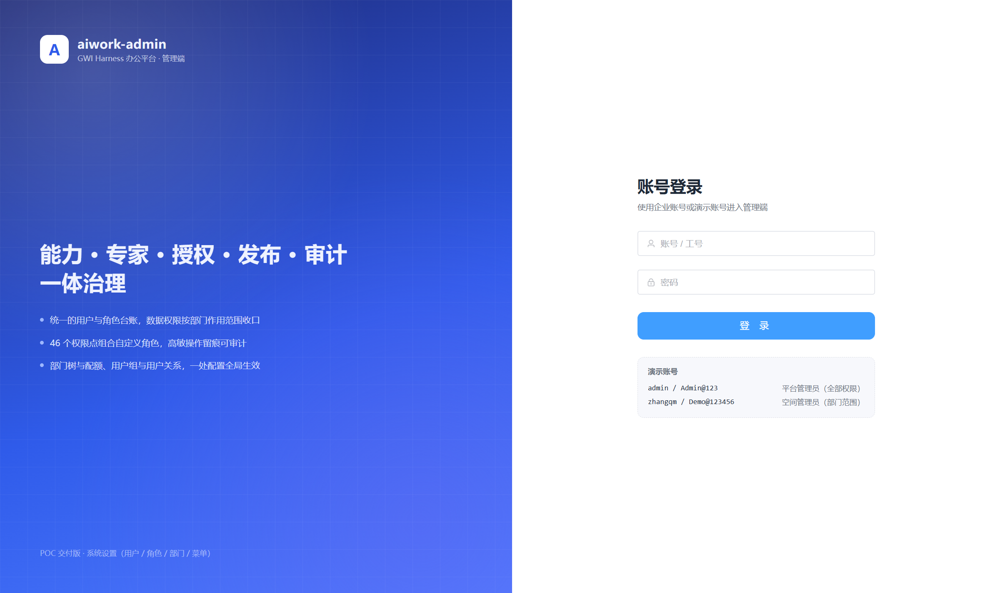

登录页界面构成：左侧深蓝品牌区（Logo + 标题 + 三条要点 + 页脚版本标注），右侧表单区（账号/工号、密码、登录按钮、演示账号卡片）。表单校验规则：账号必填（提示「请输入账号或工号」）、密码必填（「请输入密码」）；支持回车提交。

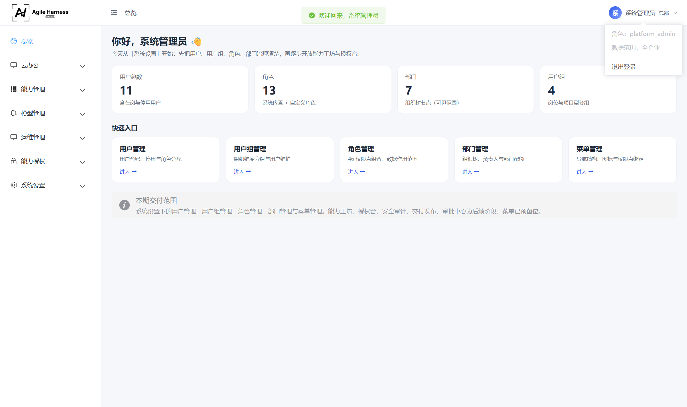

页头右上角为用户区（首字母头像 + 姓名 + 部门 + 下拉箭头），点开后三项：只读展示「角色：platform_admin」「数据范围：全企业」，「退出登录」（二次确认「确定退出当前账号吗？」）。

### 0.4 全局布局

- **左侧栏**：品牌 Logo（可折叠，展开 236px / 收起 64px）+ 动态菜单树，支持二级折叠与角标（如「审批中心 4」）。
- **页头**：折叠按钮 + 面包屑（由菜单树回溯生成，如「系统设置 / 菜单管理」）+ 用户区。
- **主区**：统一采用「页面标题 + 一句话职责说明 + 右上操作按钮 → 卡片/筛选栏 → 表格/树 → 分页」的结构。

### 0.5 信息架构（6 目录 / 31 节点）

```
总览                     /overview
云办公                   /workspace        → 工作区管理
能力管理                 /capability       → 技能 / 连接器 / 组件 / 专家 / 知识库 / 审批中心 / 分类
模型管理                 /model            → 模型列表 / 用量统计
运维管理                 /ops              → 镜像管理
能力授权                 /authz            → 授权台 / 能力目录 / 申请审批 / 权限复核
系统设置                 /system           → 用户 / 用户组 / 角色 / 部门 / 菜单 / 统一登录配置
```

完整节点（含路由、组件、权限点、排序）见[附录 A](#附录-a-完整菜单树31-节点)。

---

## 1 总览 `/overview`

**权限点**：无（登录后即可见） · **组件**：`OverviewView`

### 职责
管理端首页。给出当前管理员身份、四个核心台账的数量、五个高频入口，以及本期交付范围的文字说明。

### 界面构成
自上而下：

1. **欢迎区**：`你好，系统管理员 👋` + 一句话引导（「今天从『系统设置』开始：先把用户、用户组、角色、部门治理清楚，再逐步开放能力工坊与授权台。」）+ 右上绿色标签「全企业管理员」（按 `dataScope` 判定，部门范围管理员显示「部门范围管理员」）。
2. **统计卡（4 项）**：用户总数 11（含在岗与停用用户）／角色 13（系统内置 + 自定义角色）／部门 7（组织树节点（可见范围））／用户组 4（岗位与项目型分组）。
3. **快速入口（5 卡）**：用户管理、用户组管理、角色管理、部门管理、菜单管理，每卡一句职责 + 「进入 →」。无权限的卡置灰不可点。
4. **本期交付范围提示条**（info alert）。

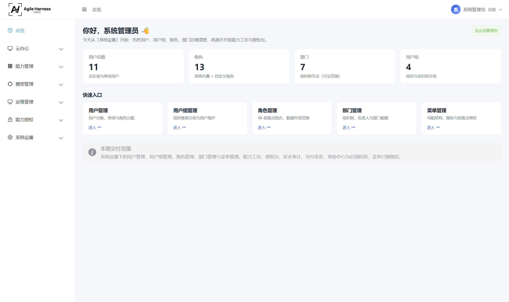

### 关键规则
- 四张卡的数据来自四个接口的 `total` 字段（`/api/users`、`/api/roles`、`/api/depts`、`/api/user-groups`），并发拉取，失败则不更新。
- 快速入口卡片按 `hasPermission` 判断是否置灰，点击前再做一次权限校验。
- 卡片副标题里的「角色管理：46 权限点组合」为**硬编码文案**，与角色管理页实际显示的 77 个权限点不一致（见附录 C-3）。

### 限制
页面无任何表格与操作按钮，纯导航型首页。数据量小（用户 11、部门 7），无分页需求。

---

## 2 云办公 · 工作区管理 `/workspace/list`

**权限点**：`workspace:read`（工作区查看） · **组件**：`workspace/WorkspacesView`

### 职责
为平台用户开通独立的 GWI Harness 工作区（K8s 命名空间 `gwih-<工号>`），支持开通、变更、停止与回收。这是「一人一云电脑」的交付面。

### 界面构成
- **页头**：标题「云办公 · 工作区管理」+ 说明「为系统内用户开通独立的 gwi-harness 工作区（K8s 命名空间 gwih-<工号>），支持开通、变更、停止与回收。」+ 按钮「刷新」「开通工作区」。
- **状态统计卡（4）**：运行中 2（占用 CPU / 内存）／已停止 0（数据保留，可随时启动）／启动中 / 异常 0（暂无异常）／编排服务（K8s 直连 incluster；`admin` 无集群权限，操作经此代理）。
- **筛选栏**：工号/姓名/部门/镜像搜索框 + 状态下拉 + 分页（共 2 个）。
- **表格列**：用户 / 状态 / 访问地址 / 规格 / 镜像 / 创建时间 / 操作。

| 用户 | 状态 | 规格 | 镜像 | 创建时间 |
| --- | --- | --- | --- | --- |
| 何志强 `1069115` · 信息技术部 | 运行中 | 500m / 1Gi，存储 20Gi | `.../gwih-harness-web:0.2.2-rc.3-enterprise.3` | 11/13 15:43 |
| 1233456 `1233456` | 运行中 | 500m / 1Gi，存储 20Gi | `.../gwih-harness-web:0.2.2-rc.3-enterprise.4` | 11/16 15:58 |

- **操作列**：`登录链接`（带一次性 token 的免登地址）、`停止`、`变更`、`回收`。

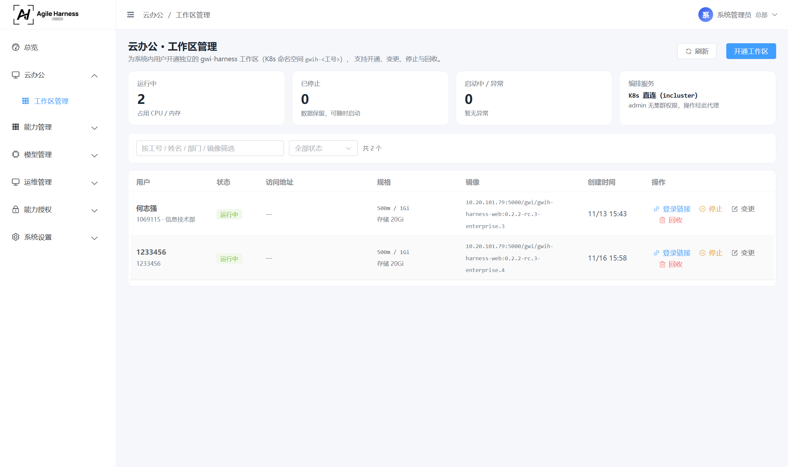

### 功能界面

**开通工作区**（`02-2`）：字段为用户（按工号或姓名搜索，仅列出还没开通的用户）、镜像（选择 `gwi/gwih-harness-web` 标签，共 4 个，留空用平台默认）、CPU（占位 500m）、内存（1Gi）、工作区存储（20Gi，`local-path` 不支持在线扩容，开通后不可改大）、会话存储（10Gi，挂到 `/home/dsh/.dsh`，存对话记录与登录凭据）。

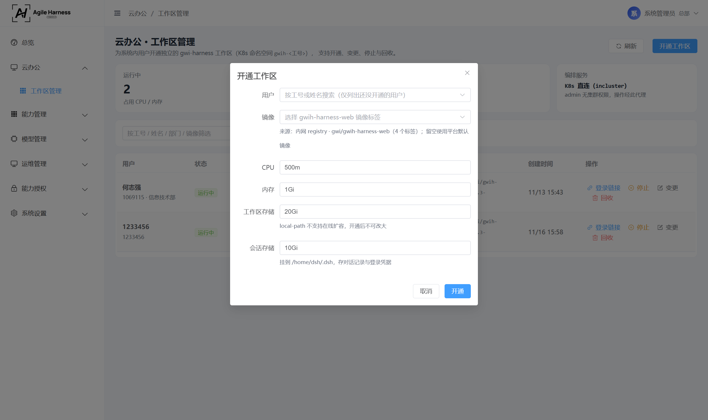

**变更工作区**（`02-3`）：可改镜像、CPU 请求、内存请求；提示「改镜像会触发滚动重启；留空表示沿用当前镜像」，按钮为「保存并重启」。

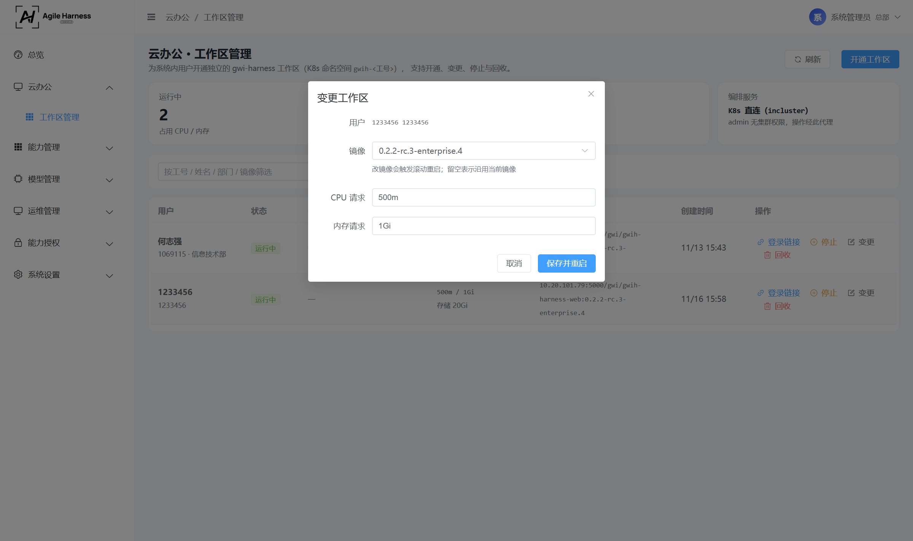

**停止工作区确认**（`02-4`）：提示释放 CPU / 内存，但数据全部保留、随时可再启动。

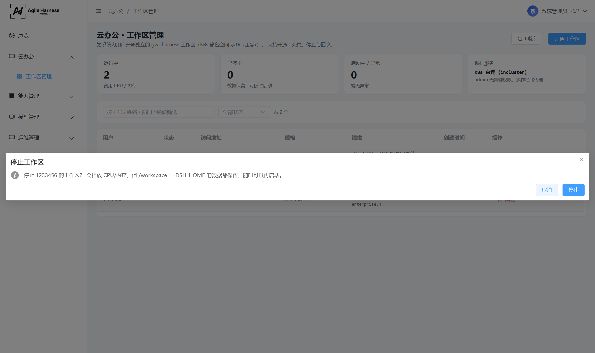

**回收工作区（危险）**（`02-5`）：红色危险弹窗，明示「会删除命名空间 `gwih-<工号>` 及其 PVC，用户所有文件与对话记录都会永久丢失且不可恢复」，要求手工输入工号二次确认（输入不匹配不执行），按钮为「确认回收」。

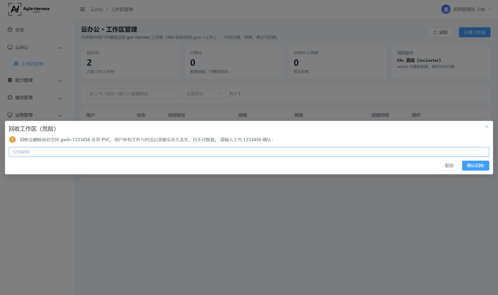

### 关键规则
- 命名空间由工号推导，同一用户仅一个工作区。
- 停止 ≠ 删除：停止只缩副本、保留 PVC；回收才删 PVC，且必须输入工号匹配。
- 集群操作全部经编排服务代理，管理端本身不持有 kubeconfig。
- 访问地址列为 `—` 表示 NodePort 未暴露，需走集群内域名 `gwih-<工号>.internal`。

---

## 3 能力管理 · 技能管理 `/capability/skills`

**权限点**：`skill:read`（技能查询） · **组件**：`capability/SkillsView`

### 职责
登记、校验、送审、上下架「技能」（`SKILL.md` 形态的提示词能力包），是能力工坊的第一类资产。

### 界面构成
- 页头：标题 + 按钮「刷新」「新增技能」。
- 筛选栏：搜索技能名/中文名、审核状态、上架状态、分类。
- 表格列：技能（名称 + 一句话 description）/ 分类 / 载体 / 版本 / 调用量 / 负反馈 / 审核状态 / 上架状态 / 操作。

| 技能 | 分类 | 载体 | 版本 | 调用量 | 负反馈 | 审核 | 上架 |
| --- | --- | --- | --- | --- | --- | --- | --- |
| meeting-minutes（把会议记录整理成结构化纪要…） | — | SKILL.md | v0.3 | 0 | — | 草稿 | 未上架 |
| weekly-report（按周汇总工作项…） | 通用岗 | SKILL.md | v1.0 | 2.1k | — | 已审核 | 已上架 |
| table-clean（识别表头与数据类型…） | 数据岗 | SKILL.md | v1.2 | 9.8k | 12 | 已审核 | 已上架 |
| due-report-draft（按监管要求起草尽调底稿…） | 风控岗 | SKILL.md + 模板 | v2.3 | 4.2k | 3 | 已审核 | 已上架 |
| contract-risk-checklist（按条款维度生成合同风险清单…） | 合规岗 | SKILL.md | v0.1 | 0 | — | 已审核 | 已上架 |
| meeting-minutes-draft（把会议原始记录整理成结构化纪要…） | 通用岗 | SKILL.md | v0.1 | 0 | — | 已审核 | 已上架 |

- 操作列：`详情` + `删除`（草稿/未上架）或 `下架`（已上架）。

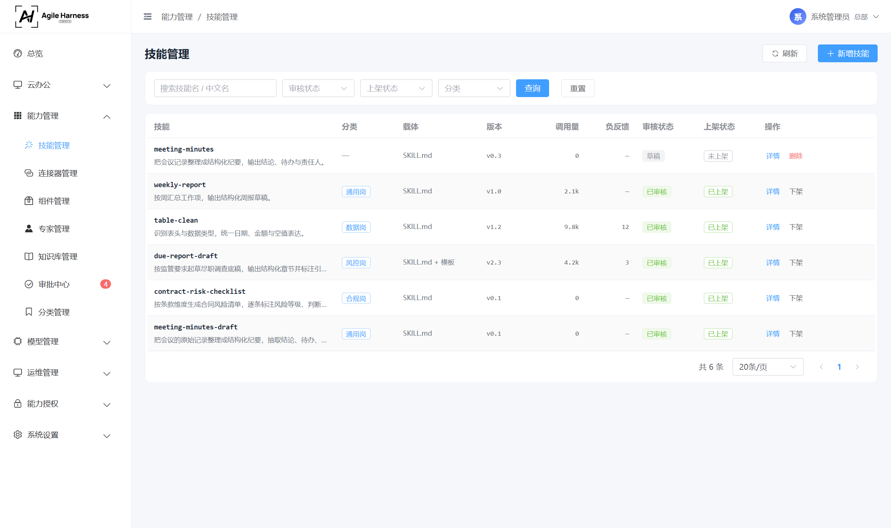

### 功能界面

**新增技能**（`03-2`）：三块——上传 `SKILL.md`（拖入或点击，上传后自动扫描并回填名称与说明，校验未通过不允许保存）、技能名称（kebab-case）、分类（取自分类管理字典）、技能说明。规则原文：「与 DSH 一致：只允许小写字母、数字与连字符，不能用连字符开头/结尾，例如 `due-report-draft`」。底部按钮「校验」「取消」「保存并提交审核」。

前端内置的 SKILL.md 结构校验覆盖（来自 chunk 文案）：首行必须 `---`、frontmatter 必须闭合、不支持嵌套结构与块标量、字段名 `skills` 已废弃、布尔值必须 true/false、技能名合规性、必填字段缺失、说明过长建议精简、正文为空/只有 frontmatter、配套文件缺失、包外引用、外部命令依赖、外网访问地址、高危命令（删除、管道执行安装脚本、提权、格式化）等十余类，命中高危项时提示「建议安全组复核」。

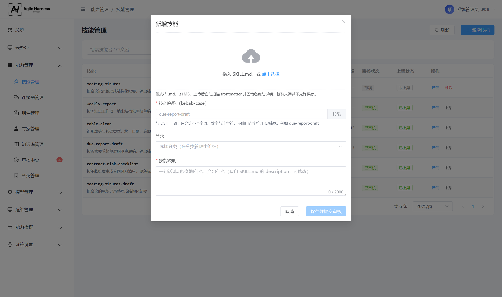

**技能详情**（`03-3`，右侧抽屉）：分区为「元数据（frontmatter）」「版本（1）」「审核记录（1）」「SKILL.md 对象存储」（给出对象键 `skills/<uuid>/versions/v0.1/SKILL.md`）「引用（0）」，底部提示「暂无引用：该技能尚未被组件 / 专家 / 授权台引用」。

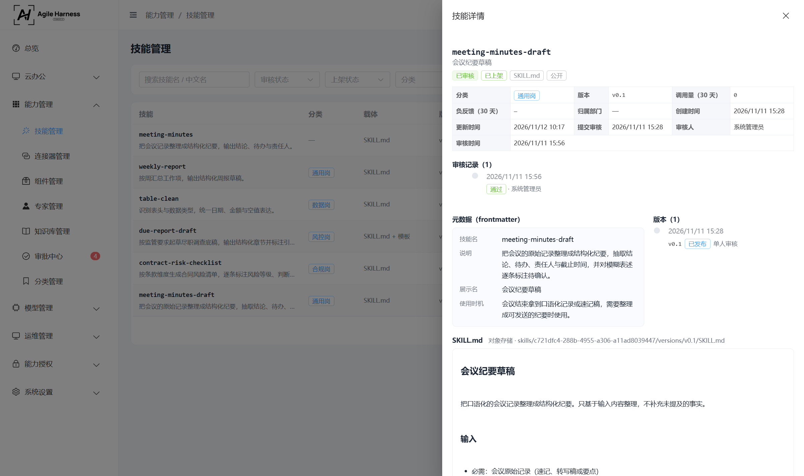

### 关键规则
- 状态机：草稿 → 已审核（上架前必须过审批中心）→ 已上架 ⇄ 已下架。
- 未上架技能可物理删除；已上架只能下架。
- 版本由 SKILL.md 内容指纹推导，同名再上传即新版本。
- 调用量与负反馈来自运行时埋点，用于「自进化」候选识别。

---

## 4 能力管理 · 连接器管理 `/capability/connectors`

**权限点**：`connector:manage`（连接器管理） · **组件**：`capability/ConnectorsView`

### 职责
登记外部系统接入（MCP / REST OpenAPI / CLI 等），只登记「引用与启用状态」，凭据本体托管在 vault，不落库、不出现在接口响应与日志里。

### 界面构成
- 页头：标题 + 「刷新」「新增连接器」。
- **双标签页**：「服务端注册 13」（可管理）/「端侧自动发现 只读」。
- 筛选栏：连接器名/标识、接入方式、探测状态，分页 20 条。
- 表格列：连接器（名称 + 标识）/ 接入方式 / 协议 / 执行位置 / 凭证引用 / 探测 / 工具数 / 启停状态 / 审批状态 / 操作。

典型行：

| 连接器 | 接入方式 | 协议 | 执行位置 | 凭证引用 | 探测 | 工具数 | 审批 |
| --- | --- | --- | --- | --- | --- | --- | --- |
| 冒烟连接器 `smoke-conn-smoke077678` | MCP | STDIO | — | —（无凭证） | 未探测 | 0 | 草稿 |
| OA 审批接口（草稿）`oa-approval-draft` | REST OpenAPI 导入 | HTTPS | gateway-01 | `cred#o••••-01` 托管 | 未探测 | 0 | 草稿 |
| 知识库（WeKnora）`weknora-kb` | MCP 远程 HTTP | HTTP | 10.20.101.92 | `vault:••••mcp` 轮换 | 端点可达（HEAD 401）| — | 已上架 |

- 操作列随状态变化：草稿态 `详情 探测 提交审核 编辑 删除`；已上线态 `详情 探测 停用 轮换 托管`。

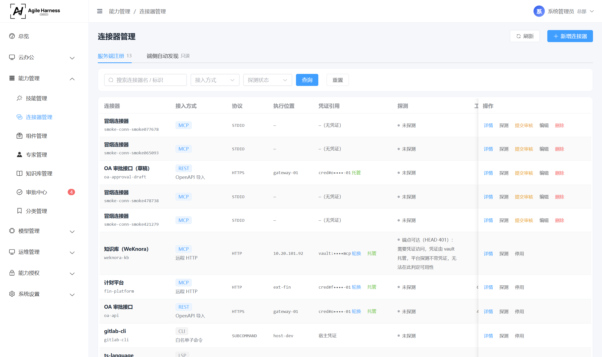

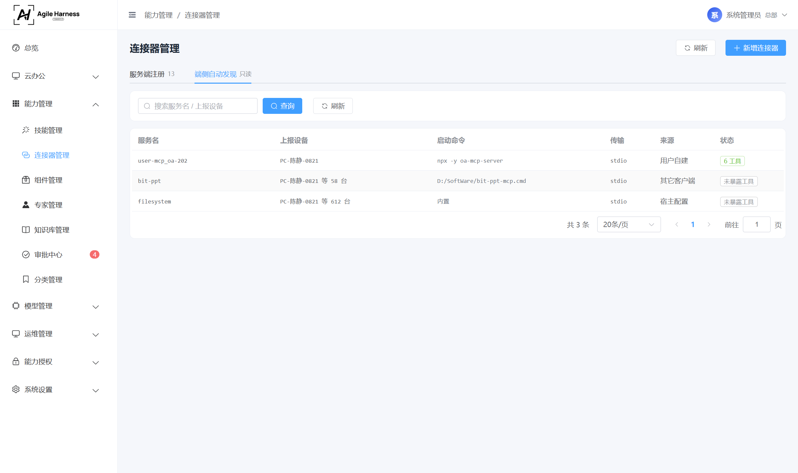

### 功能界面

**新增连接器**（`03-5`，分步向导）：第一步「接入方式与连接信息」——连接器名称、标识（kebab-case，创建后不可修改，授权关系与审计按标识追溯）、接入方式（MCP / REST OpenAPI 导入 / CLI 等）、传输方式（远程 HTTP / 本地 stdio / 白名单子命令）、协议（留空按接入方式与端点自动推导）、端点地址、执行位置（如 `gateway-01 / host-dev`）、工具数（含「其中写工具」，用于授权台提示影响面，写操作默认按高敏处理）、说明、凭证托管（vault 加密托管 / 宿主凭证 / 无凭证）、凭证引用（如 `cred#wx-01` 或 `vault://apps/wecom`，**只填引用不贴明文密钥**）。

规则原文：「本页只登记引用与启用状态；凭证内容不落库、不出现在接口响应里。轮换走双密钥并行 5 分钟，避免断流。」「保存后自动做一次连通性探测；宿主侧接入方式（CLI / LSP / 本地 stdio）服务端无法直连，会如实标记为未探测。」

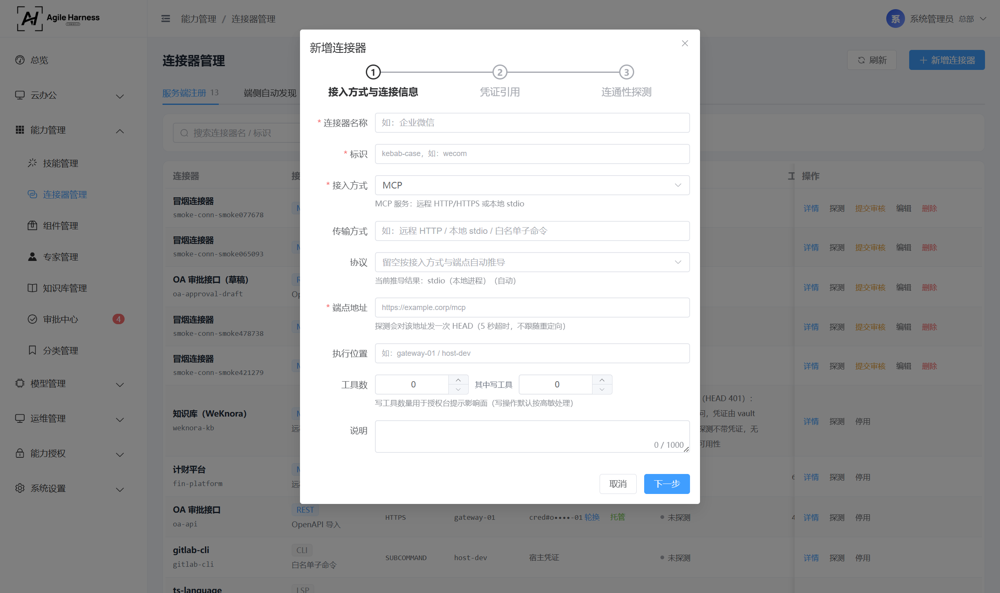

**连接器详情**（`03-6`，右侧抽屉）：分区「基本信息（接入方式/传输/协议/端点/执行位置/工具数含写工具数/启停/审批）」「鉴权」（提供「显示完整引用」按钮，提示「仅存引用，密钥由 vault 托管；接口与日志不会返回密文」）「最近探测」「生效授权」「目录刷新」「引用关系（0）」「凭据轮换记录（0）」。

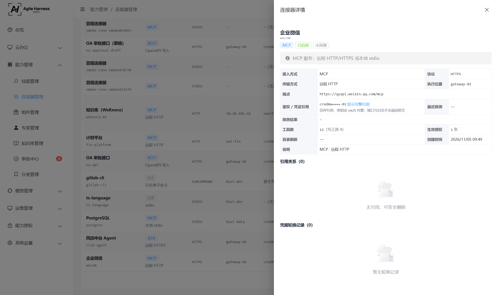

### 关键规则
- 标识创建后不可改；同标识重复登记视为版本更新需要走审批。
- 敏感配置变更会触发「连接器已暂停并重新提交审批」。
- 「存在引用，禁止删除」：被技能/专家引用的连接器需先解除引用。
- 端侧自动发现标签为只读，数据来自客户端上报。

---

## 5 能力管理 · 组件管理 `/capability/components`

**权限点**：`capability:read`（能力查询） · **组件**：`capability/ComponentsView`

### 职责
管理 DeepSeek Harness 的 bundle 插件包（`plugin.json` + `agents` / `commands` / `skills`），上传后进待审核，通过并上架后才能被授权台分配给部门与成员；同时对外提供插件市场源，供客户端在线安装。

### 界面构成
- 页头：标题 + 说明（组件 = bundle 插件包…）+ 「上传组件」。
- **统计卡（4）**：组件总数 5（当前页含历史版本 7 个）／待审核 0（审批在「审批中心」完成，通过前不可授权）／已上架 5（可在授权台分配）／已下架·已驳回 0 / 0。
- **插件市场源卡**：「已上架 4 个组件 / 7 个版本，可被 DeepSeek Harness 客户端在线安装」，展示索引地址 `http://10.20.101.79:30100/api/market/index.json` + 「复制索引地址」按钮，说明配置路径：客户端 → 插件市场 → 添加市场源 → 粘贴索引地址；客户端按 npm 语义从 `/api/market/registry/` 拉取，只分发「已审核 + 已上架」组件。
- 筛选栏：组件名/标识、审核状态、上架状态、来源。
- 表格列：组件 / 构成 / 当前版本 / 来源 / 审核状态 / 上架状态 / 授权引用 / 更新时间 / 操作。

| 组件 | 构成 | 当前版本 | 来源 | 授权引用 |
| --- | --- | --- | --- | --- |
| 能力工坊 `@gwi/dsh-workshop`（cordis 插件） | 客户端 ✓ · patch ✓，共 213 文件 · 1.12 MB | v0.3.2（1 个版本） | 内部自研 | 0 |
| `@local/dsh-workspace-upload` | 客户端 — · patch —，共 0 文件 | v1.2.0（1 个版本） | 内部自研 | 0 |
| `@gwi-ai/dsh-plugin-know` | 客户端 ✓ · patch ✓，共 222 文件 · 2.16 MB | v0.1.6（4 个版本） | 内部自研 | 0 |
| `@gwi-ai/dsh-plugin-data-querying` | 客户端 ✓ · patch ✓，共 11 文件 · 12.3 KB | v0.1.2（1 个版本） | 内部自研 | 0 |

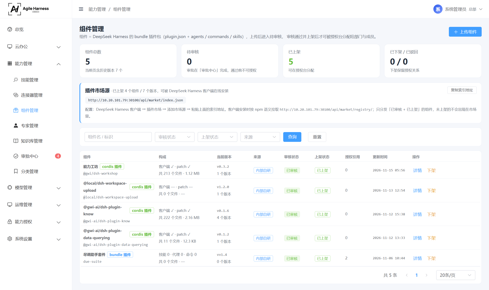

### 功能界面

**上传组件**（`03-9`）：字段「安装包」（单文件 ≤ 20MB 的 `.zip`，可带一层顶层目录，上传后自动解析 `plugin.json`）、「来源」（内部自研 / 供应商 / 社区）、「说明」。提示两种合法形态：① cordis 插件：`package.json`（name/version 必填，含 dsh 段或 `cordis.patch.yml`）+ `lib/`、`client/`；② bundle 插件：`plugin.json` + `com.deepseek.harness` 下的 agents/commands + `skills/`。按钮「取消」「上传并提交审批」。

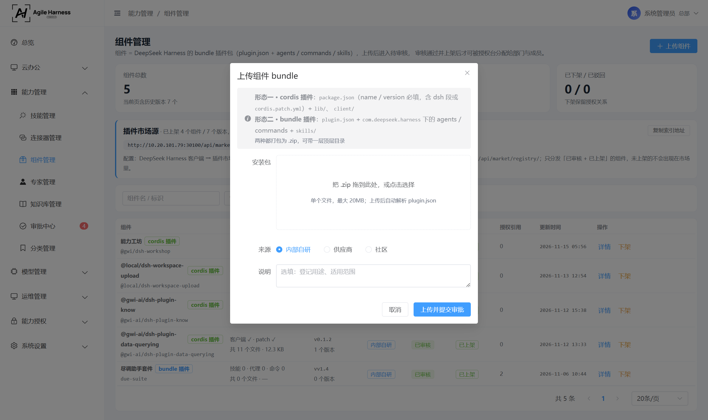

**组件详情**（`03-10`，右侧抽屉）：当前版本与历史版本列表、可「切换当前版本」（提示「已授权用户下次拉取即使用该版本」）、授权引用、审计轨迹、「下架」（提示「下架后该组件不再对已授权用户可用，但不会删除授权关系」）、「删除」（提示「删除会同时移除审批中心里的这条待办」）。

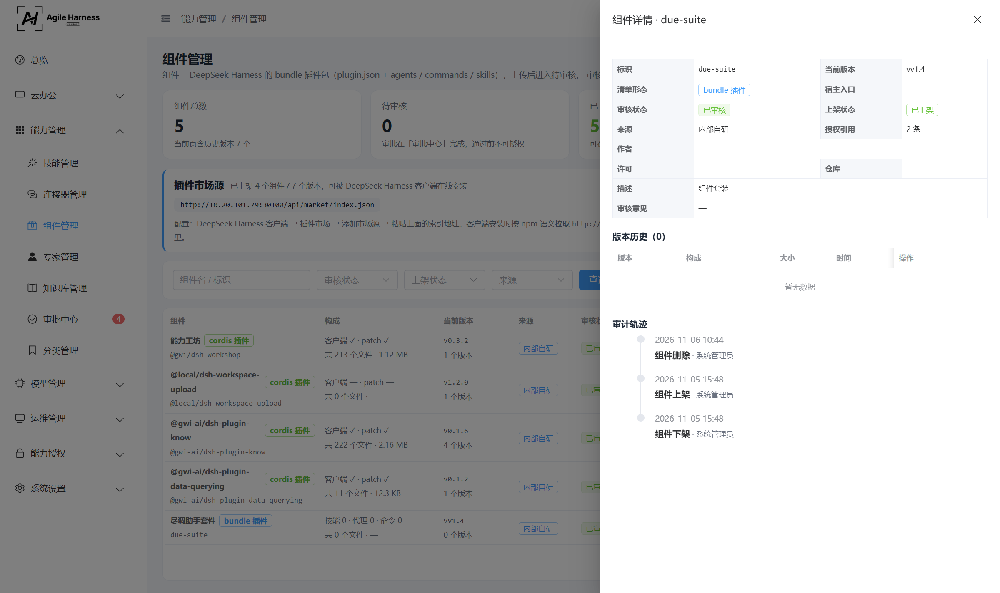

### 关键规则
- 状态机：待审核 → 已审核 → 已上架 ⇄ 已下架；已驳回可「重新提交」。
- 授权引用数 > 0 时禁止删除。
- 市场源只分发已审核 + 已上架的组件与版本，下架即从市场消失。

---

## 6 能力管理 · 专家与专家团 `/capability/experts`

**权限点**：`capability:read` · **组件**：`capability/ExpertsView`

### 职责
管理「专家」（Agent Plugin 包：`plugin.json` + `skills/<id>/SKILL.md`，可选 `agents/*.md`、`mcp.json`）与「专家团」（多专家编排单元）。

### 界面构成
- 页头：标题「专家与专家团」+ 「上传专家包」。
- **双标签页**：「专家（9）」「专家团（3）」。
- 筛选栏：名称/标识、分类、审核状态、上架状态。
- 表格列：专家 / 分类 / 版本 / 摘要 / 工具白名单 / 审核状态 / 上架状态 / 更新时间 / 操作。

| 专家 | 分类 | 版本 | 工具白名单 | 审核 | 上架 |
| --- | --- | --- | --- | --- | --- |
| 纠纷案件助手 `dsh-dispute-assistant` | 合规岗 | v0.1.0（1 个版本） | 0 个 | 待审核 | 未上架 |
| 法律助手 `dsh-legal-assistant` | 开发 | v0.1.0 | 0 个 | 已审核 | 已上架 |
| 合同助手 `dsh-contract-assistant` | 合规岗 | v0.1.0 | 0 个 | 已审核 | 已上架 |
| 尽调分析师·副本2 `due-analyst-copy26046` | 风控岗 | v— 手工登记 | 2 个（写 1） | 已审核 | 已上架 |

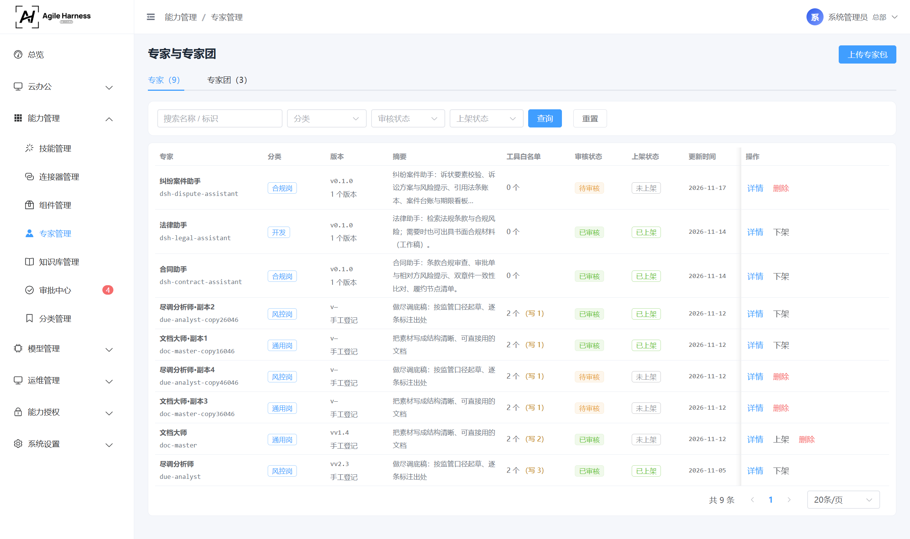

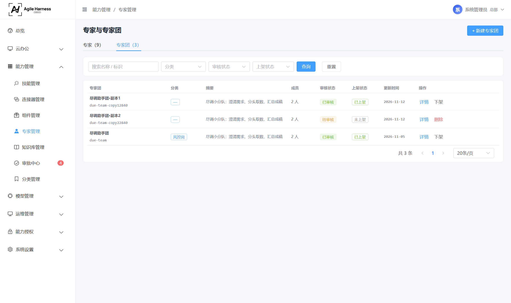

### 功能界面

**上传专家包**（`03-12`）：上传方式三选一——压缩包 / 本地文件夹 / 安装包（单文件 ≤ 20.00 MB）；分类（取自分类管理，字典为空时提示先去建分类）；来源（内部自研 / 供应商 / 社区）。

规则原文：「专家包 = Agent Plugin 包：`plugin.json` + `skills/<id>/SKILL.md`，可选 `agents/*.md`、`mcp.json` 等；可带一层顶层目录。上传即提交审批：通过后才上架。包内 `plugin.json` 的 name 去 scope 后作为专家标识，同标识再上传即作为新版本（版本号取 version）。包内技能与 MCP 只登记、不自动注册；平台不执行包内脚本。」

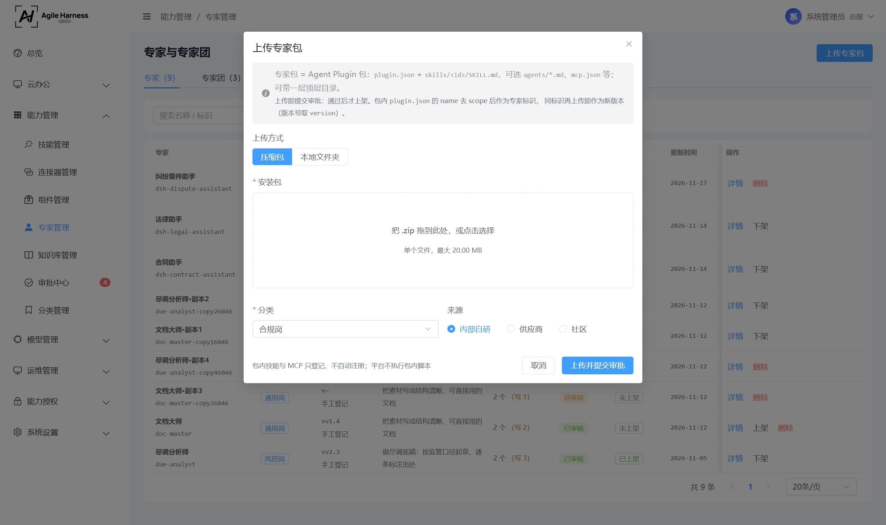

> 补充：专家详情抽屉（未单独截图，已在字段抽取中确认）分区为「画像」「版本历史」「工具白名单 N 个（写 M）」，手工登记的专家会标注「该专家由早期表单/脚本创建，没有导入包」。

### 关键规则
- 专家团额外字段：团队名称、团队标识（小写字母开头，含小写字母/数字/连字符）、团队定位、执行模式（serial / parallel / auto）、干预模式（auto / step）、成员清单（每成员须选专家）；保存即提交审批。
- 审批通过才上架；可下架、再上架、删除（审批中删除会同步移除审批中心待办）。

---

## 7 能力管理 · 知识库管理 `/capability/knowledge`

**权限点**：`knowledge:read`（知识源查看） · **组件**：`capability/KnowledgeBaseView`

### 职责
规划中：维护专家可检索的知识资产（切片策略、嵌入模型、文档上传与索引）。

### 界面构成
页面标题 + 说明 + 一张空态卡片：`知识库管理模块建设中，当前仅完成目录结构`，下方「规划能力」清单：

- 知识库列表：关键词 / 状态筛选、分页、按数据范围过滤
- 知识库详情：切片策略、嵌入模型、文档数量
- 文档列表、上传与索引（异步任务占位）、删除文档
- 新建 / 编辑 / 删除（被专家引用时阻断）

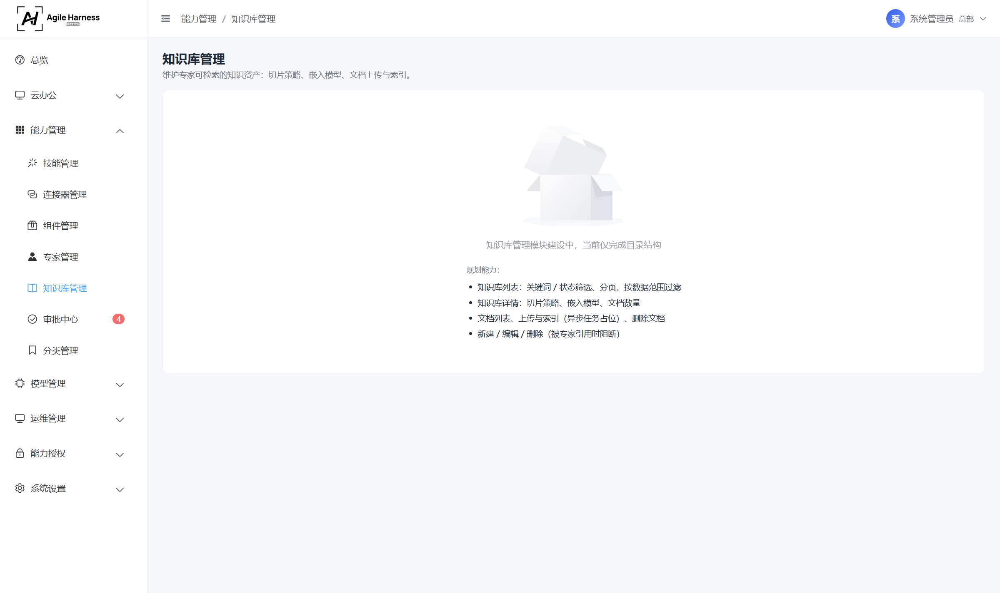

### 限制
**本页无任何可操作控件**，chunk 体积仅 1.07 KB，是全站唯一纯占位页面。但授权台的能力目录里已出现「尽调知识包」这类 `knowledge` 类型资产，说明知识库数据由其他途径（种子数据/接口）产生，页面尚未接上。

---

## 8 能力管理 · 审批中心 `/capability/approval`

**权限点**：`approval:read`（审批查看）；处理动作需 `approval:handle` · **组件**：`capability/ApprovalCenterView`

### 职责
统一裁决技能 / 连接器 / 组件 / 专家 / 专家团的上下架申请，是「登记 → 审批 → 发布 → 授权 → 留痕」主干的闸门。侧边栏带角标显示待办数（采集时为 4）。

### 界面构成
- 页头：标题 + 「刷新」。
- **状态标签行**：全部 / 技能 / 连接器 / 组件 / 专家（角标 2）/ 专家团（角标 1）——角标为该类型待审数，合计与侧栏角标一致。
- **状态筛选**：待审核 / 已审核 / 已驳回 + 搜索名称/标识。
- 表格列：类型 / 目标 / 申请人 / 提交时间 / 等待 / 状态 / 结论 / 操作。

| 类型 | 目标 | 申请人 | 提交时间 | 等待 | 结论 |
| --- | --- | --- | --- | --- | --- |
| 专家 | `doc-master-copy36046` 文档大师·副本3 | 系统管理员 总部 | 2026/11/12 09:39 | 5d | 待审批 |
| 专家 | `due-analyst-copy46046` 尽调分析师·副本4 | 系统管理员 总部 | 2026/11/12 09:39 | 5d | 待审批 |
| 专家团 | `due-team-copy22840` 尽调助手团·副本2 | 系统管理员 总部 | 2026/11/12 09:40 | 5d | 待审批 |
| 专家 | `dsh-dispute-assistant` 纠纷案件助手 | 系统管理员 总部 | 2026/11/17 13:23 | 7m | 待审批 |

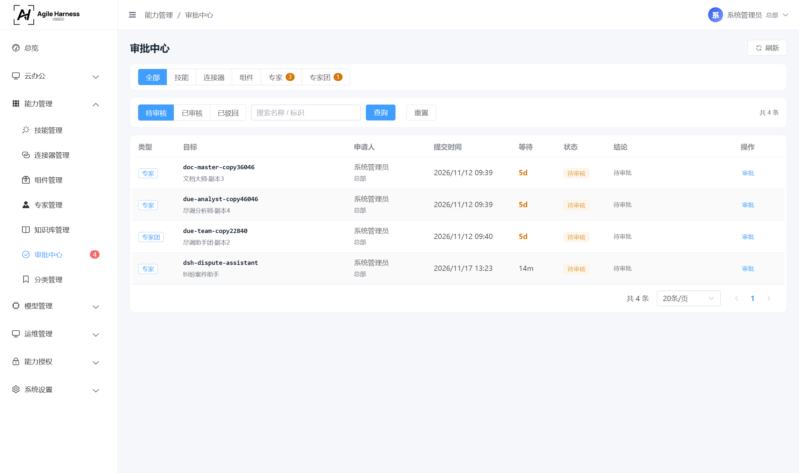

### 功能界面

**审批详情**（`03-16`，右侧大抽屉）：标题形如「专家团上架审批 · due-team-copy22840」。分区：

1. **提交快照**：名称/标识、正文指纹（如 `f86ead40265daff9…`）、分类、指定模型（继承会话路由）、工具数 0、成员数 2、提交人、提交次数（第 1 次）、提交人·部门、提交时间。
2. **配置预览**：团队编排（分类、定位、指定模型、工具白名单、协作模式 JSON、协作模板、成员 2 人及各自职责）、能力介绍、擅长领域、任务示例。
3. **黄色提示条**：「通过后：该专家团上架，可被授权台分配给部门/用户组；成员的上下架状态独立维护。」
4. **流转记录**：时间线（提交 · 系统管理员）。
5. **审批状态**：标签「待审核」。
6. **审批意见**：文本域，占位「通过可选填；驳回必填（原因会展示给提交人并写入流转记录）」，计数器 0/500。
7. 底部动作按钮：「驳回」「通过并上架」。

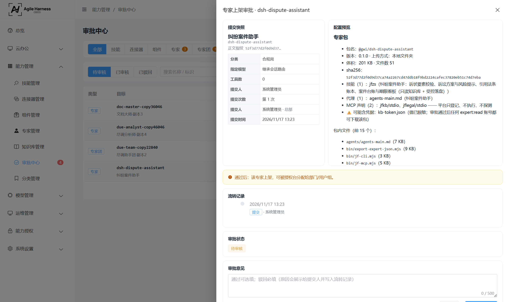

### 关键规则
- 驳回必填原因且写入流转记录；通过可选填。
- 一期只有系统管理员有处理权限，其他账号进详情只能看（页面明示「当前账号仅可查看：审批操作需要 xxx 权限」）。
- 已裁决工单不可再操作（「该工单已 …不可再操作」）。
- 若正文不可读则提示「内容暂不可读，无法据此通过（可以驳回）」——避免盲批。
- 通过后同一事务内改资产状态并记录审计，不产生「待发放」中间态。

---

## 9 能力管理 · 分类管理 `/capability/categories`

**权限点**：`capability:read` · **组件**：`capability/CategoriesView`

### 职责
维护能力分类字典——新建专家/技能时的「分类」下拉与列表筛选取自这里。

### 界面构成
- 页头：标题 + 说明 + 「+ 新增分类」。
- 筛选：搜索分类名称 + 查询。
- 表格列：分类名称 / 描述 / 操作（删除）。

| 分类 | 描述 |
| --- | --- |
| 合规岗 | 合规审查类专家：条款比对、风险提示与留痕 |
| 开发 | 开发 |
| 数据岗 | 数据分析类专家：取数、清洗、指标口径与结论 |
| 设计 | 设计 |
| 运营 | 运营 |
| 运营岗 | 运营类专家：活动策划、内容运营与增长分析 |
| 通用岗 | 通用办公类专家：写作、整理、汇总与日常问答 |
| 风控岗 | 风控与尽调类专家：口径核验、取数验证、监管报送 |

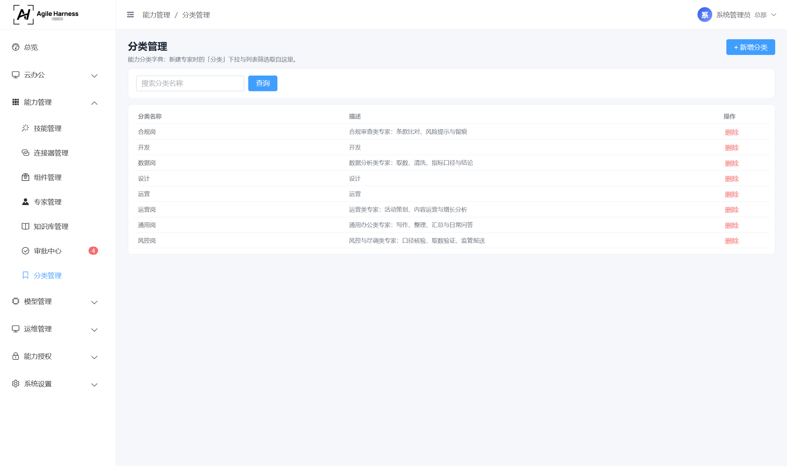

### 功能界面
**新增分类**（`03-18`）：两个字段——分类名称（占位「如 风控」）、描述（占位「这个分类负责什么」），按钮「取消」「保存」。规则：分类名称必填。

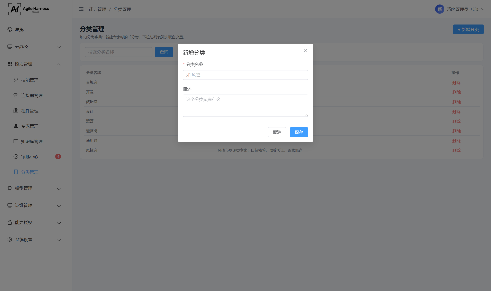

### 关键规则
- 删除已被引用的分类时会弹二次确认并明示影响：「该分类下还有 N 个专家：删除后这些专家的分类值保留，但字典里不再出现该分类」，确认后提示「已删除（N 个专家保留原分类值）」。
- 分类是纯字典，不含权限语义。

---

## 10 模型管理 · 模型列表 `/model/list`

**权限点**：`model:read`（模型查询） · **组件**：`model/ModelsView`

### 职责
登记自定义模型（上游网关/别名）并授权到人；客户端通过 `/api/ai/v1` 使用，额度按 token 计量。

### 界面构成
- 页头：标题 + 说明 + 「刷新」「新建模型」。
- **统计卡（4）**：模型总数 3（启用 3 · 停用 0）／绑定人数 6（覆盖 2 个部门）／额度合计 17,000 万（按人员额度累加）／已使用 10.9 万（整体使用率 0.1%）。
- 筛选栏：模型名称/编码/上游模型、协议、状态。
- 表格列：模型名称 / 协议 / 上游模型 / 状态 / 绑定人数 / 额度合计 / 已使用 / 操作。

| 模型 | 协议 | 上游模型 | 状态 | 绑定 | 额度 | 已使用 |
| --- | --- | --- | --- | --- | --- | --- |
| glm-5.3 `glm-5.3-flash` | OpenAI 兼容 | glm-5.3-flash | 启用 | 1 人 | 2,000 万 | 2.2 万 |
| kimi-k2.8 `kimi-k2.8-preview` | OpenAI 兼容 | kimi-k2.8-preview | 启用 | 1 人 | 2,000 万 | 0.0 万 |
| deepseek-Pro-v4 `deepseek-v4-pro` | OpenAI 兼容 | deepseek-v4-pro | 启用 | 2 人 | 4,000 万 | 8.7 万 |

- 操作列：`详情` `编辑` `选择人员` `停用` `删除`。

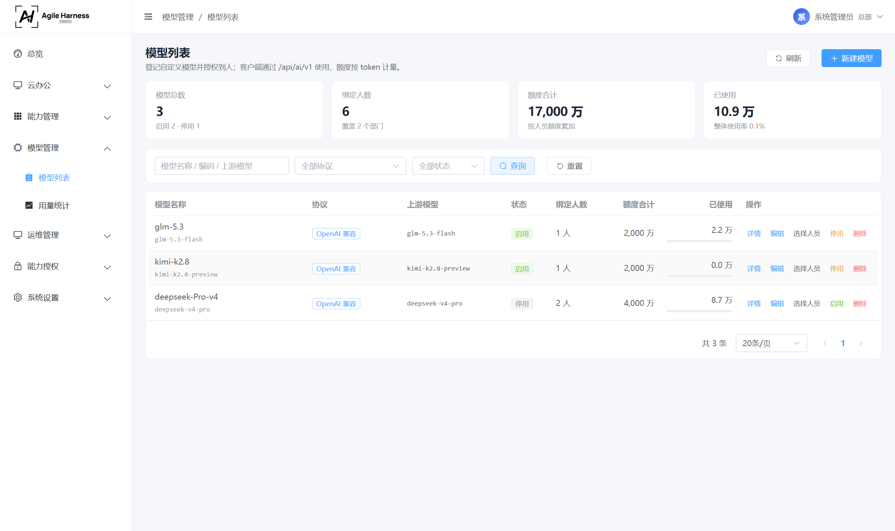

### 功能界面

**新建模型 / 编辑模型**（`04-2`）：字段分组——基本信息（模型名称、模型编码、API 协议、上游模型名、基础 URL、API Key、状态、排序）、模型能力（上下文窗口、最大输出、输入类型 文本/图片、单次超时、能力开关：支持流式 / 支持工具调用 / 支持推理等级、请求兼容、备注）。

规则原文：「客户端请求的 model 字段即此值，创建后不可修改」「转发给上游的 model 值，通常与模型编码一致；上游 id 与客户端编码不同（如别名）时才需要区分。」「探测会请求 `{基础 URL}/models`」「保存后仅回显掩码，服务端加密存储」「启用后对已绑定人员可见」。编辑态 API Key 占位变为「已保存 `sk-****2bn8`，留空保持不变」。按钮「测试连接」「取消」「保存」。

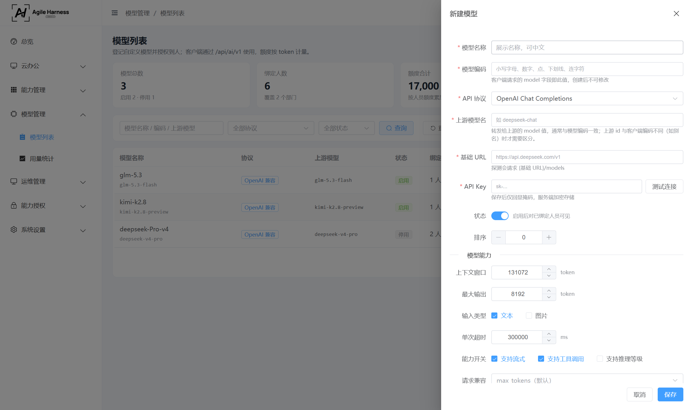

**模型详情 · 人员额度**（`04-3`，右侧抽屉）：绑定人员表（搜索姓名/工号、状态筛选、分页），操作「查询」「添加人员」「调整额度」「解除绑定」。调整额度支持「增量调整 / 设为绝对值」「增加 / 减少」，校验「调整后额度不能小于已使用量」「调整后额度不能低于已使用量」，并要求填原因。

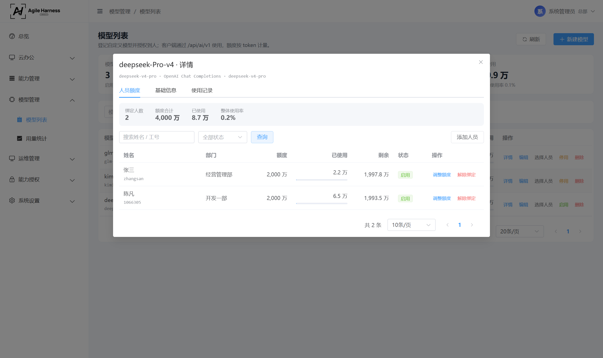

### 关键规则
- 编码规则：小写字母、数字、点、下划线、连字符；创建后不可改。
- 绑定人员时按「部门默认额度」初始化个人额度；之后改部门默认只影响新绑定人员。
- 测试连接会真实请求上游 `/models` 并返回模型数量或失败原因。

---

## 11 模型管理 · 用量统计 `/model/usage`

**权限点**：`model:read` · **组件**：`model/UsageView`

### 职责
按模型、部门、用户三个视角查看 token 消耗与额度使用率。

### 界面构成
- 页头：标题 + 说明 + 时间范围下拉「近 7 天」+ 「导出」。
- **指标卡（4）**：调用次数 15（暂无上一周期数据）／总 token 10.9 万（输入 10.8 万 · 输出 0.0 万）／活跃用户 2（占绑定人数 50.0%）／额度使用率 0.1%（额度合计 17,000.0 万）。
- **按模型**：横向条形图（条形长度为该模型的 token 占比）——deepseek-Pro-v4 8.7 万、glm-5.3 2.2 万、kimi-k2.8 0.0 万。
- **按部门表**：部门 / 绑定人数 / 额度合计 / 已使用 / 使用率 / 人均用量。

| 部门 | 绑定人数 | 额度合计 | 已使用 | 使用率 | 人均用量 |
| --- | --- | --- | --- | --- | --- |
| 开发一部 | 1 | 6,000 万 | 8.7 万 | 0.1% | 8.7 万 |
| 经营管理部 | 1 | 2,000 万 | 2.2 万 | 0.1% | 2.2 万 |

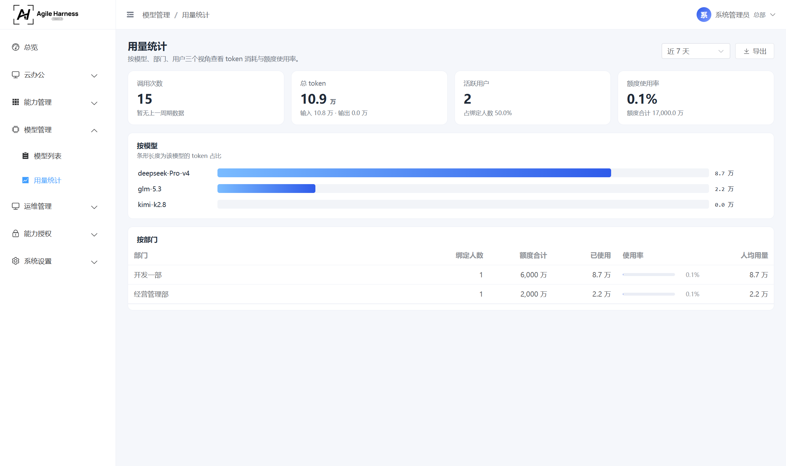

### 限制
时间窗选项以「近 7 天」为主；无上一周期数据时不画对比。导出按钮触发 `export:create` 权限链路（当前未实测落盘）。

---

## 12 运维管理 · 镜像管理 `/ops/images`

**权限点**：`image:read`（镜像查询） · **组件**：`registry/ImagesView`

### 职责
内网镜像仓库的镜像查看与上传。上传入口用于**没有构建机**的场景：把 `docker save` 出来的 `.tar` 拖进来，后端解析归档并推入仓库。

### 界面构成
- 页头：标题 + 说明 + 「刷新」「上传镜像」。
- **统计卡（3）**：镜像数量 37（仓库 + 标签的组合数）／占用空间 23.3 GB（各镜像配置与层之和，层会去重，实际占用更小）／仓库地址 `http://10.20.101.79:5000`（HTTP，无鉴权；仅限内网访问）。
- 筛选：按仓库名/标签/摘要筛选，共 37 条。
- 表格列：镜像 / 大小 / 层数 / 创建时间 / 摘要 / 操作（复制地址、删除）。

| 镜像 | 大小 | 层数 | 创建时间 | 摘要 |
| --- | --- | --- | --- | --- |
| `gwi/admin:1.0.0` | 533 MB | 9 | 2026/11/11 11:35 | ef82069394e9 |
| `gwi/admin:1.0.1` | 533 MB | 9 | 2026/11/11 11:01 | 5416b46d160c |
| `gwi/admin:1.0.10` | 468 MB | 9 | 2026/11/13 14:14 | 7e237c2017ee |
| `gwi/admin:1.0.11` | 468 MB | 9 | 2026/11/13 14:39 | e64e5818c374 |

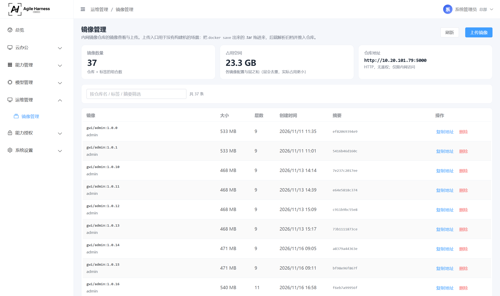

### 功能界面
**上传镜像**（`05-2`）：字段「镜像归档」（拖入或点击选择 `.tar`，提示用 `docker save <镜像> -o image.tar` 或 `buildah push <镜像> docker-archive:image.tar` 生成）、「仓库名」（例如 `dsh-runtime`，留空则从归档里的镜像名推导，会自动加命名空间前缀 `gwi/`）、「标签」（例如 `0.2.2-rc.1`）。上传后进度到 100% 仍需等待后端解析归档并推送各层。

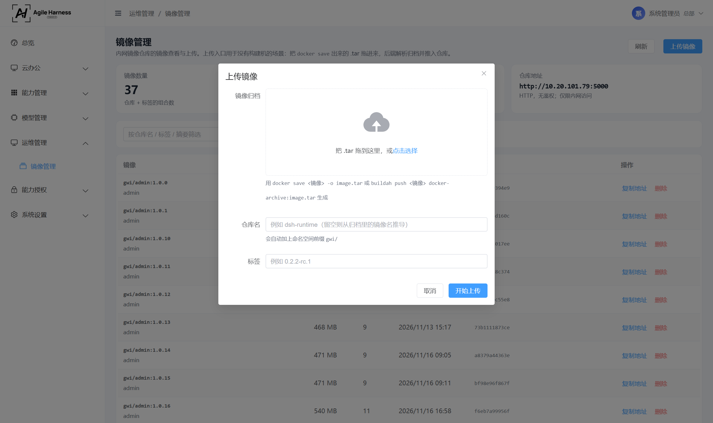

### 关键规则
- 删除镜像只删仓库清单，**registry 不会自动回收磁盘**，需运维在仓库侧执行 GC 才真正释放空间（页面明确提示）。
- 也可从构建机直接 `docker push` 到 `10.20.101.79:5000/gwi/...`，管理端只是便捷入口。

---

## 13 能力授权 · 授权台 `/authz/desk`

**权限点**：`authz:query`（授权查询） · **组件**：`authz/AuthzDeskView`

### 职责
授权的**发放与撤销**主界面。页面自述：「一页一表单：选能力 → 选对象 → 选效果与期限 → 填说明。授权只决定能否使用，不含账号、密钥与管理权限；deny 优先于一切允许。」

### 界面构成
- 页头：标题 + 上述说明 + 「查用户权限」「新增授权」。
- **统计卡（4）**：有效授权关系 11（deny 优先于一切允许）／部门授权 3（默认不含下级部门）／用户组 / 个人授权 4 / 4（多来源取允许并集）／30 天内到期 1（到期前 7 天、1 天提醒）。
- 筛选栏：能力或对象名称、能力类型、对象类型、效果 + 查询，共 11 条有效授权。
- 表格列：能力（名称 + 类型 + 写工具数）/ 对象（名称 + 类型）/ 效果 / 有效期 / 来源 / 说明 / 操作（复制、撤销）。

| 能力 | 对象 | 效果 | 有效期 | 来源 | 说明 |
| --- | --- | --- | --- | --- | --- |
| 文档大师（专家 · 写工具 2） | 王五（成员 · GT01102） | 允许使用 | 长期 | 申请 | 财务月报需要文档排版能力 |
| 尽调助手套件（组件 · 写工具 0） | 张启明（成员 · ZT00001） | 允许使用 | 长期 | 申请 | smoke 申请验证 |
| 尽调助手套件（组件 · 写工具 0） | 合规审查组（用户组） | 仅查看 | 2026-11-15（已到期） | 管理授权 | 项目组临时只读 |
| 尽调分析师（专家 · 写工具 3） | 赵敏（成员 · ZT01377） | 禁止使用 | 2026-11-30 | 管理授权 | 合规审查期临时禁用 |
| 企业微信（连接器 · 写工具 4） | 信息技术部 · 仅本部门（部门 · IT） | 允许使用 | 长期 | 管理授权 | IT 运维 |

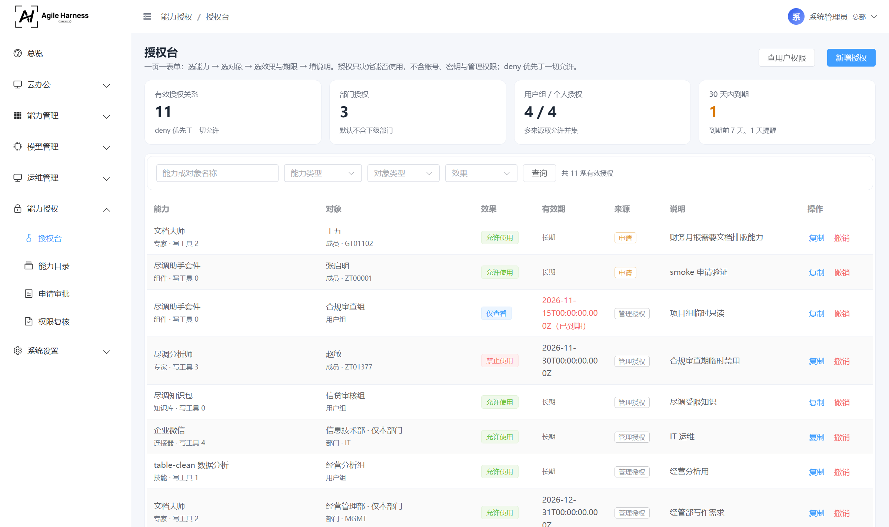

### 功能界面

**新增授权**（`06-2`，右侧大抽屉，三段式）：

1. **选择能力**（已选 0 / 20）：搜索框 + 全部分类下拉 + 能力多选清单，每行显示名称、版本、类型标签（组件/连接器/专家/专家团/技能/知识库）、写工具 N。底部统计「共 32 项可选，含 N 个写工具」。
2. **分配给谁**（已选 0）：三段页签「部门 / 用户组 / 成员」，部门可选多选并勾选「包含所选部门的下级部门（默认不含，勾选后影响面扩大）」。
3. **权限和期限**：三选一效果卡——「允许使用（可查看并调用工具）」「仅查看（不可执行工具、不可导出）」「禁止使用（短路一切允许，立即失效）」；有效期「长期 / 30 天 / 90 天 / 自定义」；「授权说明*」必填（占位「必填：业务用途或临时授权原因（用于审计与复核）」）。

底部实时汇总「0 项能力 · 0 个对象 · 0 个写工具」+ 按钮「取消」「确认授权」。

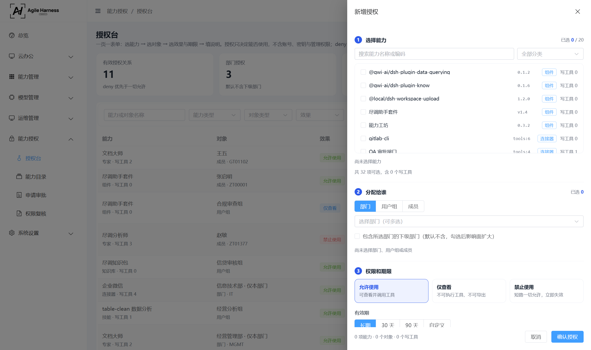

**撤销授权确认**（`06-3`）：提示「只删除这条关系，撤销后立即拒绝新调用」，并标注「已撤销该授权关系（留痕）」，按钮「保留」「确认撤销」。

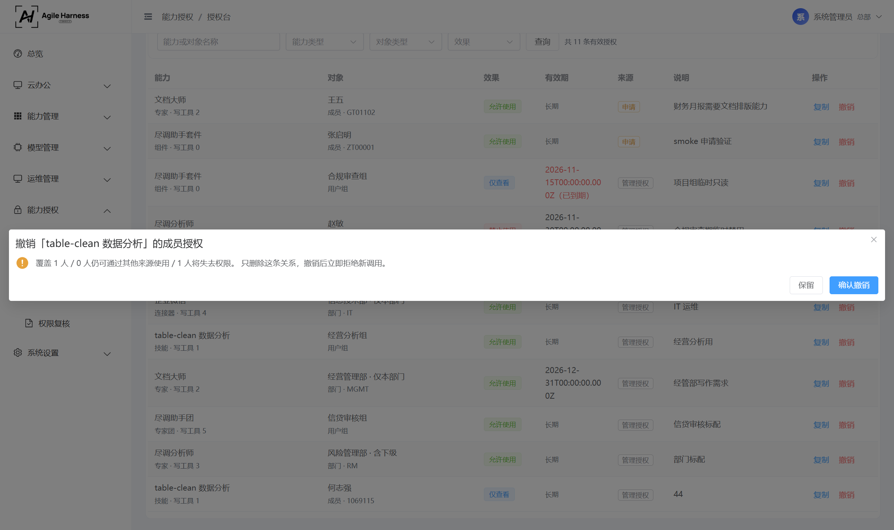

### 关键规则
- 效果优先级：`deny`（禁止使用）短路一切 `allow`，命中对象立即不可用。
- 多来源取允许并集：同一能力经部门、用户组、个人、申请四条来源叠加，任一 allow 即生效，除非被 deny 覆盖。
- 部门授权默认不递归下级，勾选后才扩大影响面。
- 写工具数量在选择时即提示影响面，写操作默认按高敏处理。
- 「查用户权限」弹窗：输入姓名或工号后点「查询」，返回形如「王五 · GT01102 · 计财部 · 有效授权 2 项」的结果表，列为 能力 / 结果（允许使用·仅查看·禁止使用）/ **来源**（如「个人：王五」「用户组：经营分析组」「部门：IT」「申请」），直接回答「凭什么能用」。
- 授权不含账号、密钥与管理权限——只决定能否使用能力。

---

## 14 能力授权 · 能力目录 `/authz/catalog`

**权限点**：无（登录后即可见） · **组件**：`authz/AuthzCatalogView`

### 职责
面向**使用者视角**的能力清单与自助申请入口：已授权可直接使用，未授权可「申请使用」，即将到期可「续期申请」。

### 界面构成
- 页头：标题 + 说明「已授权可直接使用；未授权可『申请使用』，即将到期可『续期申请』。申请提交进入审批，审批通过即在同一事务内发放生效；重复提交幂等。」
- 筛选：能力名称或编码 + 能力类型（专家/专家团/技能/连接器/知识库/组件）。
- 表格列：能力（名称 + 编码 · 类型 · 版本）/ 写工具 / 授权范围（部门 N · 用户组 N · 个人 N）/ 我的权限（可用 / 仅查看 / 禁止使用 / 未授权）/ 操作（申请使用 / 续期申请 + 「审批中」标记）。

共 32 项。典型：

| 能力 | 写工具 | 授权范围 | 我的权限 |
| --- | --- | --- | --- |
| `@gwi-ai/dsh-plugin-data-querying`（组件 · 0.1.2） | 0 | 部门 0 · 用户组 0 · 个人 0 | 未授权 |
| `@gwi-ai/dsh-plugin-know`（组件 · 0.1.6） | 0 | 部门 0 · 用户组 0 · 个人 0 | 未授权 |
| 尽调助手套件 `due-suite`（组件 · v1.4） | 0 | 部门 0 · 用户组 1 · 个人 1 | 未授权（审批中） |
| 能力工坊 `@gwi/dsh-workshop`（组件 · 0.3.2） | 0 | 部门 0 · 用户组 0 · 个人 0 | 未授权 |

- 下方「我的申请」小表：能力 / 理由 / 状态（审批中/已通过/已驳回）/ 提交时间 / 审批意见。当前 1 条：尽调助手套件 · 组件 / 理由「测试」/ 审批中 / 2026-11-05。

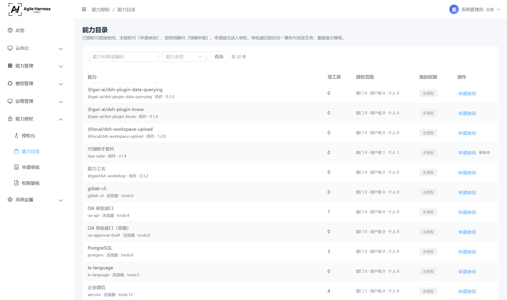

### 功能界面
**申请使用**（`06-5`）：标题形如「申请『table-clean 数据分析』」，字段「申请理由*」（占位「说明业务用途」）、「期望有效期（可选）」（占位「不填为长期」），按钮「取消」「提交申请」。提交后提示「申请已提交，等待审批；审批通过即生效」。

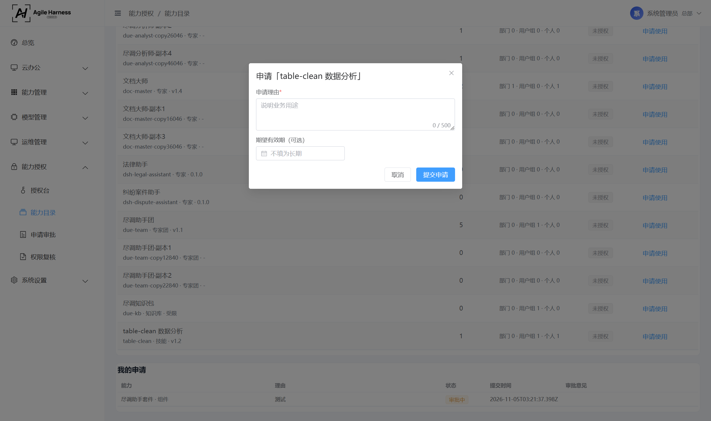

### 关键规则
- 申请幂等：同一能力重复提交不会产生多条待办。
- 审批通过即时发放（无「待发放」中间态），并写入来源标记「申请」。
- 「我的权限」按当前登录人的实际判定结果渲染，而非按角色推测。

---

## 15 能力授权 · 申请审批 `/authz/requests`

**权限点**：`authz:grant`（授权发放） · **组件**：`authz/AuthzRequestsView`

### 职责
裁决能力使用申请。页面自述：「审批即生效：通过后在同一事务内写入授权关系（来源标记为『申请』），无需『待发放』状态；不能审批自己提交的申请。」

### 界面构成
- 页头：标题 + 上述说明。
- 状态页签：待审批 / 已通过 / 已驳回，共 2 条。
- 表格列：申请人 / 能力 / 申请理由 / 期望有效期 / 提交时间 / 状态 / 操作（通过、驳回）。

| 申请人 | 能力 | 理由 | 期望有效期 | 提交时间 | 状态 |
| --- | --- | --- | --- | --- | --- |
| 王五 `GT01102` | 文档大师（专家） | 财务月报需要文档排版能力 | 长期 | 2026-11-16T07:10:33 | 待审批 |
| 系统管理员 `AD000001` | 尽调助手套件（组件） | 测试 | 长期 | 2026-11-05T03:21:37 | 待审批 |

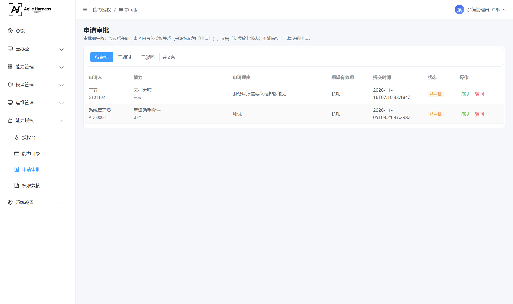

### 功能界面
**通过申请**（`06-7`）：弹窗提示「通过后将立即为该成员发放『允许使用』授权。」，审批意见可选填，按钮「取消」「确认通过」，成功后提示「已通过，授权已即时生效」。

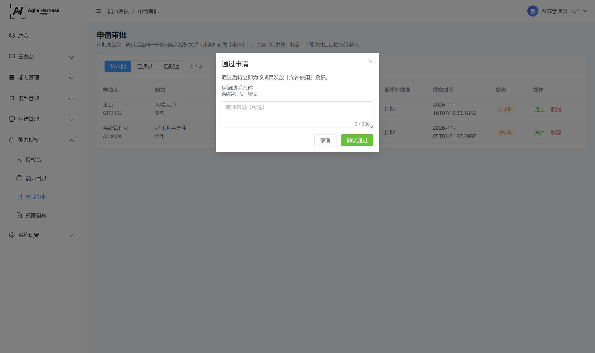

**驳回**（同页操作，弹窗结构一致）：审批意见可选填，按钮「确认驳回」，成功提示「已驳回」；「驳回后申请人可修改理由重新提交」。

### 关键规则
- **不能审批自己提交的申请**：命中时提示「不能审批自己提交的申请。」
- 通过即在同一事务写授权关系（来源=申请），失败则整体回滚。
- 驳回不删除申请记录，申请人可改理由重提。

---

## 16 能力授权 · 权限复核 `/authz/review`

**权限点**：`authz:review`（授权复核） · **组件**：`authz/AuthzReviewView`

### 职责
周期性权限体检。页面自述：「例外制：默认全部『保留』，只处理例外。例外类型含 90 天未使用、个人例外、即将到期、外部粒度受限、责任人已离职；决策为收回或改为限期 30/90 天，结论归档入审计。」

### 界面构成
- 页头：标题 + 上述说明 + 「创建复核清单」。
- 筛选：复核周期（占位「复核周期，如 2026 Q4」）。
- 表格列：周期 / 状态（进行中 / 已归档）/ 例外项 / 已标记 / 创建人 / 创建时间 / 归档时间 / 操作（处理 / 查看）。

| 周期 | 状态 | 例外项 | 已标记 | 创建人 | 创建时间 | 归档时间 |
| --- | --- | --- | --- | --- | --- | --- |
| 2026 年 Q4 | 进行中 | 7 | 0 | 系统管理员 | 2026-11-17T05:24:23 | - |
| 2026 年 Q4 | 进行中 | 7 | 0 | 系统管理员 | 2026-11-17T05:20:55 | - |
| 2026 年 Q4 | 已归档 | 6 | 0 | 系统管理员 | 2026-11-16T06:02:02 | 2026-11-16T06:41:28 |
| 2026 年 Q4 | 已归档 | 5 | 0 | 系统管理员 | 2026-11-(更早) | 2026-11-16T06:02:36 |

共 8 条（进行中 5 / 已归档 3）。

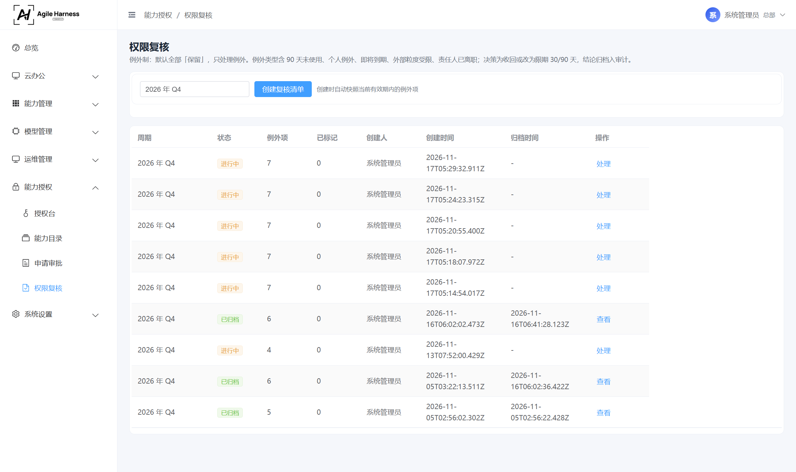

### 功能界面

**创建复核清单**（`06-9`）：填复核周期（如 `2026 Q4`），创建时自动快照当前有效期内的例外项。清单内按能力类型分组列出每条授权的能力、对象、例外类型（如「个人例外」「即将到期（30 天内）」「90 天未使用」「外部粒度受限」「责任人已离职」）、到期日、决策（默认「保留」）。顶部提示「默认保留；仅标记的例外会被执行」。底部按钮「关闭」「提交归档」。

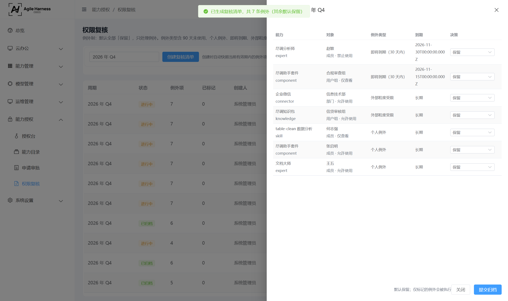

**复核处理**（`06-10`）：对已存在的清单逐条例外标记决策。表格列为 能力（名称 + 类型）/ 对象（名称 + 类型 · 当前效果）/ 例外类型（如「即将到期（30 天内）」「个人例外」）/ 到期 / 决策下拉。决策下拉实测三档：**保留 / 收回 / 改为 30 天**（默认「保留」）。底部固定提示「默认保留；仅标记的例外会被执行」，按钮「关闭」「提交归档」。

清单创建时即快照例外项，因此同一周期可存在多份清单（列表中 8 条 2026 Q4 清单，进行中 5、已归档 3），处理其中一份不影响其他。

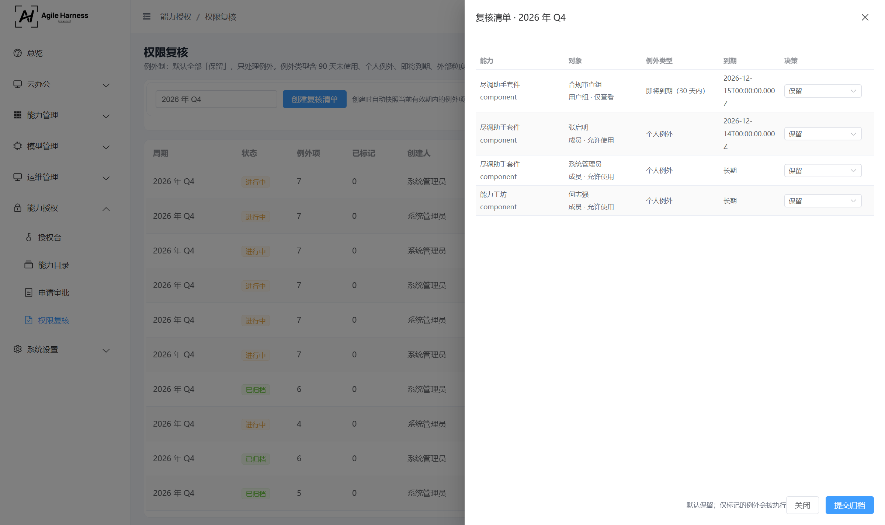

### 关键规则
- 例外制：不逐条审批全部授权，只处理被标记的例外，降低复核负担。
- 归档即执行：决策在提交时落库（收回立即失效 / 改限期重设到期日），并写审计。
- 同一周期可建多份清单（演示数据中同日多份），说明未做强唯一约束。

---

## 17 系统设置 · 用户管理 `/system/users`

**权限点**：`user:read`（成员查询） · **组件**：`system/UsersView`

### 职责
用户台账与生命周期：新增、编辑、停用/恢复、角色分配、密码重置、删除；停用优先于删除。

### 界面构成
- 页头：标题 + 说明「用户台账与生命周期：新增、停用/恢复、角色分配、密码重置；停用优先于删除。」+ 「同步身份」「添加用户」。
- 筛选：姓名/账号/工号、部门、状态。
- 表格列：用户（头像首字 + 姓名 + `@账号`）/ 工号 / 部门 / 用户组 / 角色 / 状态 / 最近活跃 / 操作。

| 用户 | 工号 | 部门 | 用户组 | 角色 | 状态 |
| --- | --- | --- | --- | --- | --- |
| 张三 `@zhangsan` | zhangsan | 经营管理部 | — | `platform_admin` | 在职 |
| 陈凡 `@1066305` | 1066305 | 开发一部 | — | `platform_admin` | 在职 |
| 本地联调 `@localdev` | LOCALDEV | — | — | — | 在职 |
| 何志强 `@1069115` | 1069115 | 信息技术部 | — | `capability_owner` | 在职 |
| 王五 `@wangwu` | GT01102 | 计财部 | 经营分析组 | `business_user` | 在职 |
| 陈静 `@chenjing` | GT00821 | 风险管理部 | 信贷审核组 | `business_user` | 在职 |
| 赵敏 `@zhaomin` | ZT01377 | 合规部 | 合规审查组 | `auditor` | 在职 |
| 张启明 `@zhangqm` | ZT00001 | 信息技术部 | 平台运维组 | `space_admin` | 在职 |

共 10 条，状态含 `在职` 与 `待清理`（停用后待清理，仅已停用用户可删除）。

- 操作列（7 项）：`编辑` `角色` `可用模型` `权限来源` `停用`/`恢复` `重置密码` `删除`。

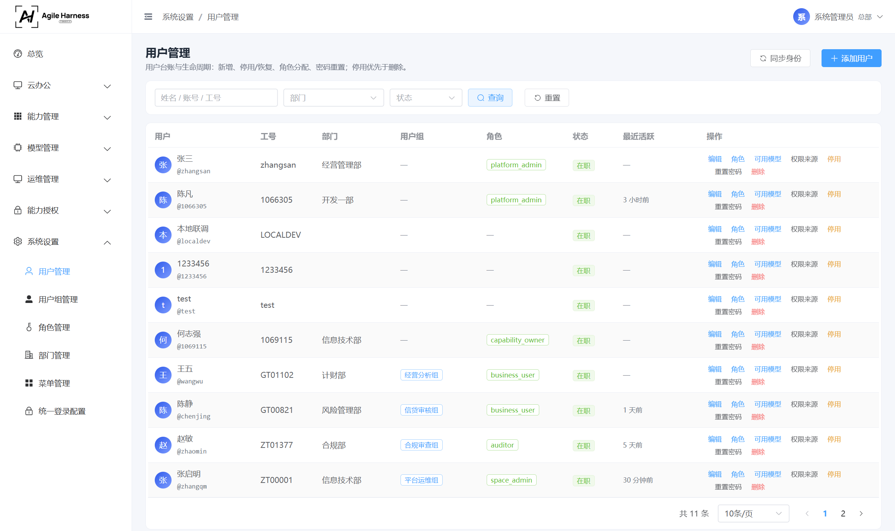

### 功能界面

**添加用户**（`07-2`，右侧抽屉）：必填「姓名」「账号」「工号」「初始密码（至少 6 位）」；选填「部门」「角色（可稍后分配）」「手机」「邮箱」。按钮「取消」「保存」。

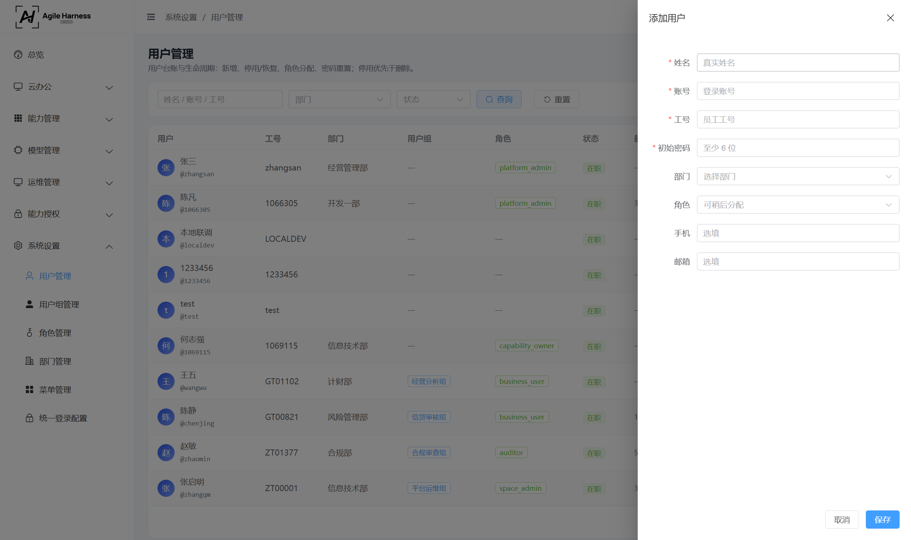

**可用模型**（`07-3`，弹窗，标题「陈凡 · 可用模型」）：副标题给出该用户的「部门 · 部门默认额度 · 已绑定 N 个模型」。表格列为 模型名称 / 额度 / 已使用 / 剩余 / 使用率 / 状态 / 操作。以陈凡为例：`deepseek-Pro-v4` 额度 2,000 万、已用 6.5 万、剩余 1,993.5 万、使用率 0.3%、启用；另有 `glm-5.3`（2.2 万 / 0.1%）、`kimi-k2.8`（0 万 / 0%）。每行带「接入模型」按钮。

底部常驻说明：「可用模型由『模型列表 → 选择人员』授权，一个人员可绑定多个模型；额度调整在『模型详情 → 人员额度』中操作。」未绑定任何模型的用户（如张启明）表格显示「该用户尚未绑定任何模型」。

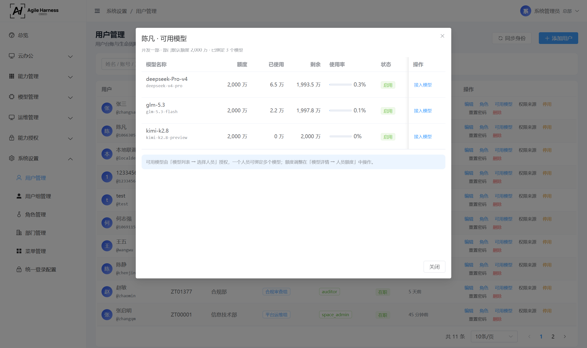

**接入模型**（`07-3b`，由上一弹窗的「接入模型」进入）：标题「接入模型 · deepseek-Pro-v4」，副标题 `deepseek-v4-pro · OpenAI Chat Completions · 陈凡`。这是用户侧接入模型网关的自助面板，全部只读 + 复制：

- **额度三栏**：额度 2,000 万 / 已使用 6.5 万 / 剩余 1,993.5 万。
- **接口地址**（可复制）：`http://10.20.101.79:30100/api/ai/v1`。说明「OpenAI 兼容基地址：`GET {地址}/models` 取模型列表，`POST {地址}/chat/completions` 发起对话；集群内可用 `http://gwih-admin.gwi-system.svc.cluster.local:3000/api/ai/v1`」。
- **模型编码**（可复制）：`deepseek-v4-pro`。说明「对话请求的 `model` 字段填此值；切换模型只改这一处。」
- **访问令牌**：默认掩码，三个动作「显示 / 复制 / 重置」；说明「长期有效，不随登录过期；重置后旧令牌立即失效，账号停用后立即拒绝。」重置需二次确认（「重置后旧令牌立即失效，已配置旧令牌的客户端需要更新。」）。
- **在 DeepSeek Harness 中配置**：可直接复制 `cordis.patch.yml` 片段——
  ```yaml
  providers:
    aiwork:
      displayName: AIWork 平台
      api: openai-completions
      baseURL: http://10.20.101.79:30100/api/ai/v1
      apiKeyEnv: AIWORK_MODEL_TOKEN
      models:
        - id: deepseek-v4-pro
          name: deepseek-Pro-v4
  ```
  说明「把片段写进 `$DSH_HOME/profiles/<profile>/cordis.patch.yml`，或在 DSH『设置 → 模型 → 自定义模型 API』按字段填写；网关按访问令牌或 DSH 登录令牌识别用户；DSH 未接入登录时，把上方长期令牌填进 API 密钥（或 `AIWORK_MODEL_TOKEN`）。」

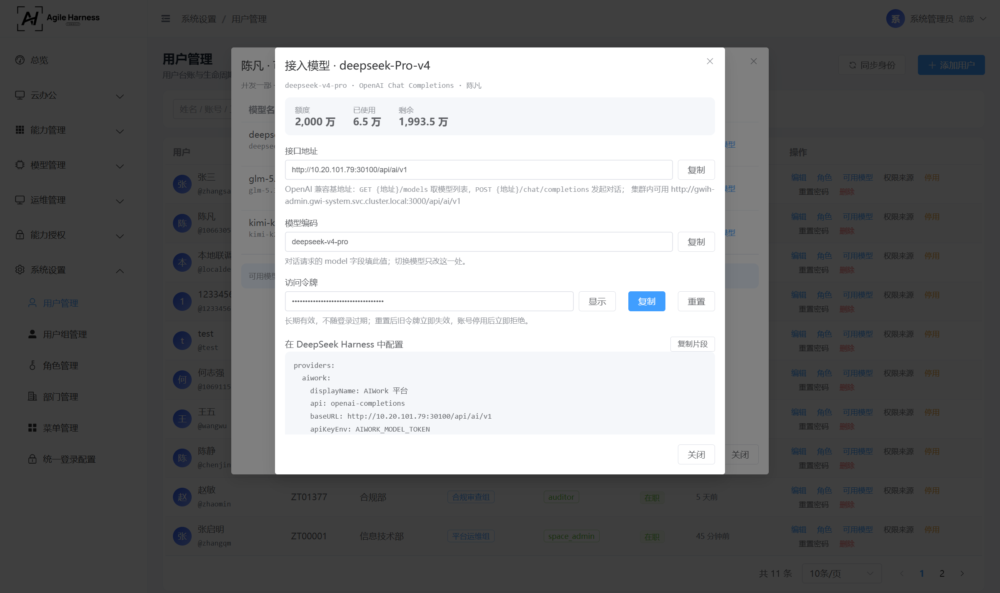

**角色分配**（`07-4`）：标题「分配角色」，多选角色，提示「为『张启明』选择角色。系统会校验职责分离互斥（授权/审批、策略/审计、发布/回滚）。」按钮「取消」「保存」。

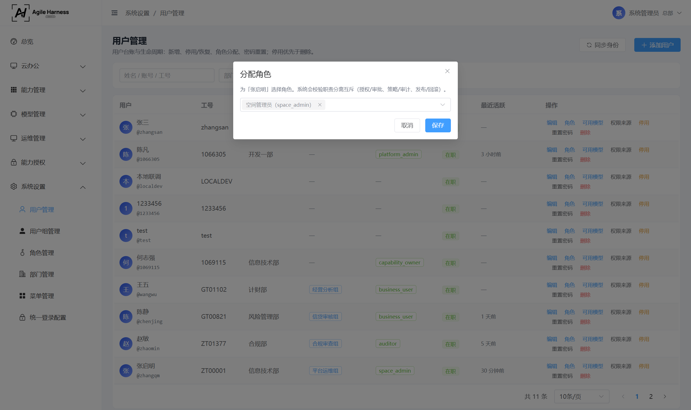

**权限来源**（`07-5`）：标题「权限来源 · 张启明」，按角色分组列出该用户最终拥有的权限点（如 `user:read`、`user:create`、`user:update`、`user:disable`、`user:reset-password`、`usergroup:read/create/update/delete`、`role:read`、`dept:read/quota/sync`、`authz:grant` …），用于解释「这个人的权限从哪来」，是审计举证的关键界面。

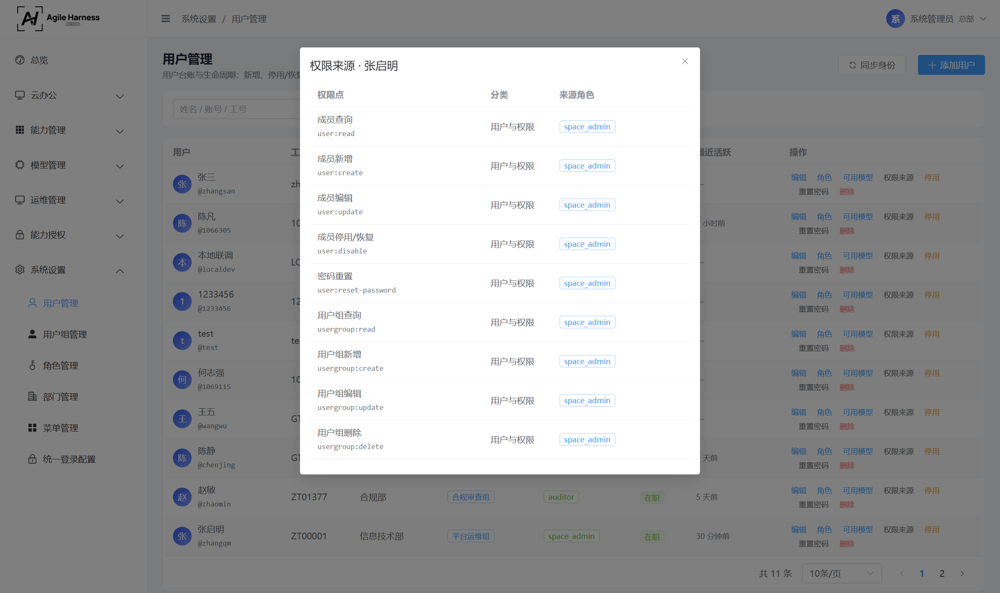

**重置密码**（`07-6`）：提示「为『张启明』设置新密码（至少 6 位）」，并有常驻警示「重置后旧令牌立即失效，已配置旧令牌的客户端需要更新」。按钮「取消」「确定」。

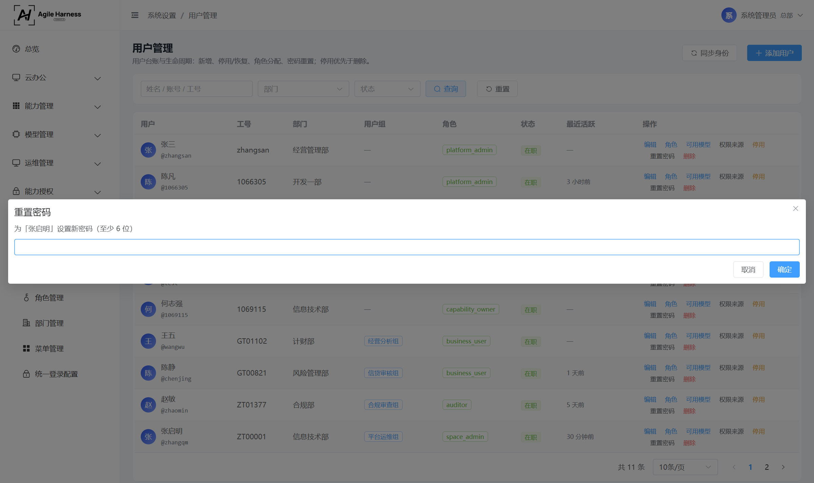

### 关键规则
- 停用提示：「停用后，其会话与令牌将立即失效，确认继续」；恢复需二次确认。
- 删除仅对已停用用户开放；删除后进入待清理状态且不可登录。
- 角色分配时校验职责分离（SoD）互斥三类：授权/审批、策略/审计、发布/回滚。
- 「同步身份」从统一身份源拉取组织与成员（`user:sync`）。

---

## 18 系统设置 · 用户组管理 `/system/user-groups`

**权限点**：`usergroup:read`（用户组查询） · **组件**：`system/UserGroupsView`

### 职责
用户组是岗位与项目型人员的集合，用于批量维护成员关系；**用户组不直接挂角色**。

### 界面构成
- 页头：标题 + 说明 + 「新建用户组」。
- 筛选：用户组名称/描述。
- 表格列：用户组（名称 + 描述）/ 成员数 / 创建时间 / 操作（编辑、成员、删除）。

| 用户组 | 描述 | 成员数 | 创建时间 |
| --- | --- | --- | --- |
| 平台运维组 | 平台运维组（演示数据） | 1 人 | 2026/11/04 15:41 |
| 合规审查组 | 合规审查组（演示数据） | 1 人 | 2026/11/04 15:41 |
| 经营分析组 | 经营分析组（演示数据） | 1 人 | 2026/11/04 15:41 |
| 信贷审核组 | 信贷审核组（演示数据） | 1 人 | 2026/11/04 15:41 |

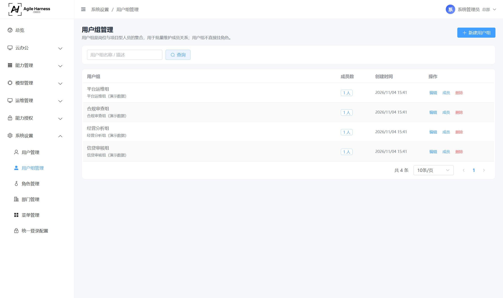

### 功能界面
**新建用户组**（`07-8`）：字段「名称」（占位「如：信贷审核组」）、「描述」（占位「用途说明（选填）」），按钮「取消」「保存」；名称必填。


**维护成员**（`07-9`）：标题「维护成员 · 信贷审核组」，成员多选，提示「已选 1 人；保存后整体替换该用户组成员。」按钮「取消」「保存」。


### 关键规则
- 成员维护为「整体替换」语义，不是增量追加。
- 删除有成员的用户组会阻断，提示「组内仍有成员时需先移除成员」。
- 用户组只在「授权台」作为授权对象使用，不承载角色。

---

## 19 系统设置 · 角色管理 `/system/roles`

**权限点**：`role:read`（角色查询） · **组件**：`system/RolesView`

### 职责
以权限点组合自定义角色，并为角色设定数据作用范围（个人 / 本部门 / 本部门及下级 / 部门集 / 全企业），限定生效边界。

### 界面构成
- 页头：标题 + 说明「46 个权限点（高敏 6）组合自定义角色；角色带数据作用范围…」+ 「新建角色」。
- **统计卡（4）**：权限点 **77**（其中高敏 12 个）／系统内置角色 9（不可删改，可复制为自定义）／自定义角色 4（按部门作用范围组合）／待生效变更 0（角色变更走审批后生效，后续阶段）。
- 筛选：角色名称/编码、类型。
- 表格列：角色（名称 + 编码）/ 类型（系统内置 / 自定义）/ 权限点（数量 + 高敏数）/ 作用范围 / 成员数 / 操作。

| 角色 | 类型 | 权限点 | 作用范围 | 成员数 |
| --- | --- | --- | --- | --- |
| 平台管理员 `platform_admin` | 系统内置 | 77（高敏 12） | 全企业 | 3 人 |
| 空间管理员 `space_admin` | 系统内置 | 21（高敏 1） | 本部门及下级 · 信息技术部 | 1 人 |
| 能力负责人 `capability_owner` | 系统内置 | 14 | 全企业 | 1 人 |
| 发布/版本管理员 `release_admin` | 系统内置 | 6（高敏 1） | 全企业 | 0 人 |
| 安全与合规 `security_compliance` | 系统内置 | 9（高敏 4） | 全企业 | 0 人 |
| 实施/运维 `ops_impl` | 系统内置 | 9 | 全企业 | 0 人 |
| 审计员 `auditor` | 系统内置 | 8（高敏 2） | 全企业 | 1 人 |
| 业务使用者 `business_user` | 系统内置 | 0 | 本部门 · 信息技术部 | 2 人 |
| 服务主体负责人 `service_principal_owner` | 系统内置 | 0 | — | — |

系统内置角色操作列只有「权限矩阵 / 复制 / 分配成员」；自定义角色额外有「编辑 / 删除」。


### 功能界面

**新建角色**（`07-11`，右侧大抽屉）：字段——角色名称（占位「如：风控空间管理员」）、角色编码（小写字母开头，如 `risk-admin`）、数据范围单选（全企业 / 本部门 / 本部门及下级 / 个人 / 部门集，下方实时显示该档语义，如「范围：全部数据，不受部门限制」「范围：仅本人创建的数据（不含他人数据）」）、说明（角色用途，选填）、权限点树（按域分组勾选，每项带编码，如「成员查询（user:read）」「成员新增（user:create）」…）。按钮「取消」「保存角色」。

校验规则：角色名称必填；编码须小写字母开头仅含小写字母/数字/连字符；至少选一个权限点；选「部门集」时至少选一个部门作为数据权限集合。


**权限矩阵**（`07-12`）：标题「权限矩阵 · <角色名>」，只读展示该角色勾选的权限点与作用范围（提示形如「共 N 个权限点；作用范围：部门集（合规部、总部）」）。


**分配成员**（`07-13`）：标题「分配成员 · <角色名>」，成员多选，提示「保存后整体替换该角色的成员；系统会校验职责分离互斥（授权/审批、策略/审计、发布/回滚）。」按钮「取消」「保存」。


### 关键规则
- 系统内置角色不可删改，只能「复制」为自定义角色再调整（复制会带入原权限点与数据范围）。
- 数据范围是权限的**作用边界**：同是 `user:read`，`本部门` 与 `全企业` 看到的数据不同。
- 部门集不自动递归下级，需显式勾选。
- 角色变更在正式版走审批后生效（当前「待生效变更 0」，功能为后续阶段）。

---

## 20 系统设置 · 部门管理 `/system/depts`

**权限点**：`dept:read`（部门查询） · **组件**：`system/DeptsView`

### 职责
组织树、负责人与部门配额；部门是数据权限与配额的核心作用域。

### 界面构成
- 页头：标题 + 说明 + 「同步组织」「新增部门」。
- **树形表格**列：部门名称（可展开/折叠）/ 编码 / 负责人 / 成员数 / 模型额度 / 人 / 排序 / 操作（编辑、新增下级、配额、删除）。

| 部门 | 编码 | 负责人 | 成员数 | 模型额度/人 |
| --- | --- | --- | --- | --- |
| 信息技术部 | IT | — | 2 人 | 2,000 万 |
| 开发一部 | dev001 | — | 1 人 | 2,000 万 |
| 合规部 | COMP | — | 1 人 | 2,000 万 |
| 总部 | HQ | — | 1 人 | 2,000 万 |
| 经营管理部 | MGMT | — | 1 人 | 2,000 万 |
| 计财部 | FIN | — | 1 人 | 2,000 万 |
| 风险管理部 | RM | — | 1 人 | 2,000 万 |

共 7 个节点。


### 功能界面

**新增部门**（`07-15`）：字段——上级部门（占位「不选则为顶级部门」）、部门名称（「如：风险管理部」）、部门编码（「如：RISK」，仅支持字母/数字/下划线/连字符）、负责人（选择器）、排序。按钮「取消」「保存」。


**部门配额**（`07-16`，标题「部门配额 · 风险管理部」）：分两块——

- **部门配额**：并发任务上限、存储配额（MB）、组件数量上限、连接器上限、每人默认额度（万 token）、额度重置周期（自然月 / 总量）、部门额度上限。
- **模型额度**：说明「配额与 License 分离；使用率达到 80% 触发告警，超出按策略拒绝。模型额度在绑定人员时下发到个人：修改部门默认额度只影响之后新绑定的人员，已有人员请在『模型详情 → 人员额度』中调整；部门额度上限填 0 表示不限制（P1 生效）。」

按钮「取消」「保存配额」，成功后提示「配额已保存（使用率 N%，触发告警）」。


### 关键规则
- 部门是数据权限作用域与配额载体，双层：部门级上限 + 个人级下发。
- 存在下级部门或成员时禁止删除，需先调整。
- 「同步组织」从统一身份源拉组织树（`dept:sync`）。

---

## 21 系统设置 · 菜单管理 `/system/menus`

**权限点**：`menu:read`（菜单查询） · **组件**：`system/MenuManagerView`

> 这是用户指定的入口页面（`http://10.20.101.79:30100/system/menus`）。

### 职责
维护系统导航结构：目录 / 菜单、路由路径、图标、排序、可见性与权限点。停用或隐藏的菜单不会出现在侧边导航，权限点决定用户是否可见。

### 界面构成
- 页头：标题 + 上述说明 + 「刷新」「新增菜单」。
- 筛选：搜索名称/标识/路由 + 状态下拉（全部状态/启用/停用）+ 查询、重置；右上「共 31 个菜单节点」。
- **树形表格**列：菜单名称（带图标，目录可展开）/ 类型（目录 / 菜单，标签）/ 路由路径（等宽字体）/ 权限点（`不限制` 或具体码）/ 排序 / 可见（显示/隐藏）/ 状态（启用/停用）/ 操作（编辑、新增下级、删除）。

完整 31 行见[附录 A](#附录-a-完整菜单树31-节点)；前几行为：

| 菜单名称 | 类型 | 路由路径 | 权限点 | 排序 |
| --- | --- | --- | --- | --- |
| 总览 | 菜单 | `/overview` | 不限制 | 10 |
| 云办公 | 目录 | `/workspace` | 不限制 | 20 |
| └ 工作区管理 | 菜单 | `/workspace/list` | `workspace:read` | 1 |
| 能力管理 | 目录 | `/capability` | 不限制 | 30 |
| ├ 技能管理 | 菜单 | `/capability/skills` | `skill:read` | 1 |
| ├ 连接器管理 | 菜单 | `/capability/connectors` | `connector:manage` | 2 |
| ├ 组件管理 | 菜单 | `/capability/components` | `capability:read` | 3 |
| ├ 专家管理 | 菜单 | `/capability/experts` | `capability:read` | 4 |
| ├ 知识库管理 | 菜单 | `/capability/knowledge` | `knowledge:read` | 5 |
| ├ 审批中心 | 菜单 | `/capability/approval` | `approval:read` | 6 |
| └ 分类管理 | 菜单 | `/capability/categories` | `capability:read` | 7 |


### 功能界面

**新增菜单**（`07-18`）：字段——上级菜单（默认「顶级菜单」）、类型（目录 / 菜单）、名称（占位「如：用户管理」）、标识（唯一标识，如 `system.users`，规则「仅允许字母、数字、下划线、点与短横线」）、路由路径（须以 `/` 开头，如 `/system/users`）、组件标识（如 `system/UsersView`）、图标（图标选择器）、权限点（默认「不限制（登录后即可见）」，可绑定具体权限点）、排序（「数字越小越靠前」）、可见（显示/隐藏）、状态（启用/停用）。按钮「取消」「保存」。


**编辑菜单**（`07-19`）：同一表单回填。以「统一登录配置」为例可看到上级=系统设置、类型=菜单、组件标识 `system/UnifiedLoginView`、图标 `Lock`、权限点 `统一登录查看(unifiedlogin:read)`。停用目录时额外弹出影响提示：「是目录，下面还有 N 个子菜单（启用 M 个）。停用目录后，这些子菜单会一起从侧边导航消失，但页面路由仍可直接访问。确定停用吗？」，并提供「仍要停用」。


### 关键规则
- 菜单类型：`目录`（仅分组，无路由页）与 `菜单`（有路由与组件）。
- 权限点为空 = 登录后即可见；填了权限点则需命中才显示。
- 停用 / 隐藏只影响侧边导航，**页面路由仍可直接访问**——这一行为在页面文案中被明确写出，属于设计取舍而非缺陷。
- 删除只移除入口，已有页面路由不受影响（提示语原文）。
- 新增菜单只改数据库配置，不会自动注册前端路由；若前端未打包对应组件，访问该路由会掉进 `/:pathMatch(.*)*` 兜底重定向到 `/`（见第 22 章）。

---

## 22 系统设置 · 统一登录配置（差异项）

**权限点**：`unifiedlogin:read`（统一登录查看） · **组件标识**：`system/UnifiedLoginView`（菜单树中存在）

### 实测结论
该菜单节点在 `/api/menus/nav` 与菜单管理列表中都存在（排序 6、图标 Lock、权限点 `unifiedlogin:read`、页面状态「启用/显示」），**但前端路由表里没有注册 `/system/unified-login`**。直接访问该路径时，登录鉴权通过后落到 Vue Router 的兜底规则 `path: "/:pathMatch(.*)*" → redirect: "/"`，最终显示总览页。

证据链：
1. `GET /api/menus/nav` 返回该节点（`code: system.unified-login`, `component: system/UnifiedLoginView`）；
2. 主包路由定义（`index-BELqBpIC.js`）中只有 22 条 `children`，不含 `system/unified-login`；
3. 浏览器实测：`goto /system/unified-login` → 最终 `location.pathname = /overview`，页面标题为「你好，系统管理员」。


### 影响与建议
- 用户点击侧边栏该菜单时会被"传送"回首页，无任何错误提示，容易被误判为「页面没做好」或「权限不足」。
- 三种修法（任选其一）：① 补 `UnifiedLoginView` 并注册路由；② 在菜单管理把该节点置为「停用/隐藏」；③ 在路由守卫中对未注册路径给出 404 提示而非静默回落。

---

## 附录 A 完整菜单树（31 节点）

来源：`GET /api/menus/nav`（与菜单管理列表一致）。

| # | 名称 | 类型 | 路由 | 组件标识 | 权限点 | 排序 | 图标 |
| --- | --- | --- | --- | --- | --- | --- | --- |
| 1 | 总览 | 菜单 | `/overview` | `OverviewView` | 不限制 | 10 | Odometer |
| 2 | 云办公 | 目录 | `/workspace` | — | 不限制 | 20 | Monitor |
| 2.1 | 工作区管理 | 菜单 | `/workspace/list` | `workspace/WorkspacesView` | `workspace:read` | 1 | Grid |
| 3 | 能力管理 | 目录 | `/capability` | — | 不限制 | 30 | Grid |
| 3.1 | 技能管理 | 菜单 | `/capability/skills` | `capability/SkillsView` | `skill:read` | 1 | MagicStick |
| 3.2 | 连接器管理 | 菜单 | `/capability/connectors` | `capability/ConnectorsView` | `connector:manage` | 2 | Connection |
| 3.3 | 组件管理 | 菜单 | `/capability/components` | `capability/ComponentsView` | `capability:read` | 3 | Box |
| 3.4 | 专家管理 | 菜单 | `/capability/experts` | `capability/ExpertsView` | `capability:read` | 4 | Avatar |
| 3.5 | 知识库管理 | 菜单 | `/capability/knowledge` | `capability/KnowledgeBaseView` | `knowledge:read` | 5 | Reading |
| 3.6 | 审批中心 | 菜单 | `/capability/approval` | `capability/ApprovalCenterView` | `approval:read` | 6 | CircleCheck |
| 3.7 | 分类管理 | 菜单 | `/capability/categories` | `capability/CategoriesView` | `capability:read` | 7 | CollectionTag |
| 4 | 模型管理 | 目录 | `/model` | — | 不限制 | 35 | Cpu |
| 4.1 | 模型列表 | 菜单 | `/model/list` | `model/ModelsView` | `model:read` | 1 | List |
| 4.2 | 用量统计 | 菜单 | `/model/usage` | `model/UsageView` | `model:read` | 2 | TrendCharts |
| 5 | 运维管理 | 目录 | `/ops` | — | 不限制 | 35 | Monitor |
| 5.1 | 镜像管理 | 菜单 | `/ops/images` | `registry/ImagesView` | `image:read` | 1 | Files |
| 6 | 能力授权 | 目录 | `/authz` | — | 不限制 | 40 | Lock |
| 6.1 | 授权台 | 菜单 | `/authz/desk` | `authz/AuthzDeskView` | `authz:query` | 1 | Key |
| 6.2 | 能力目录 | 菜单 | `/authz/catalog` | `authz/AuthzCatalogView` | 不限制 | 2 | Files |
| 6.3 | 申请审批 | 菜单 | `/authz/requests` | `authz/AuthzRequestsView` | `authz:grant` | 3 | Tickets |
| 6.4 | 权限复核 | 菜单 | `/authz/review` | `authz/AuthzReviewView` | `authz:review` | 4 | DocumentChecked |
| 7 | 系统设置 | 目录 | `/system` | — | 不限制 | 90 | Setting |
| 7.1 | 用户管理 | 菜单 | `/system/users` | `system/UsersView` | `user:read` | 1 | User |
| 7.2 | 用户组管理 | 菜单 | `/system/user-groups` | `system/UserGroupsView` | `usergroup:read` | 2 | UserFilled |
| 7.3 | 角色管理 | 菜单 | `/system/roles` | `system/RolesView` | `role:read` | 3 | Key |
| 7.4 | 部门管理 | 菜单 | `/system/depts` | `system/DeptsView` | `dept:read` | 4 | OfficeBuilding |
| 7.5 | 菜单管理 | 菜单 | `/system/menus` | `system/MenuManagerView` | `menu:read` | 5 | Menu |
| 7.6 | 统一登录配置 | 菜单 | `/system/unified-login` | `system/UnifiedLoginView` | `unifiedlogin:read` | 6 | Lock |

注：目录 5 行 + 菜单 26 行 = 31 节点；其中 `/system/unified-login` 前端未注册路由。

---

## 附录 B 权限点清单（77 个）

来源：`admin` 登录响应中的 `permissions` 数组（`platform_admin` 持有全部权限点），按域归类。

| 域 | 权限点 |
| --- | --- |
| 用户（user） | `user:read` `user:create` `user:update` `user:delete` `user:disable` `user:reset-password` `user:sync` |
| 用户组（usergroup） | `usergroup:read` `usergroup:create` `usergroup:update` `usergroup:delete` |
| 角色（role） | `role:read` `role:create` `role:update` `role:delete` `role:assign` |
| 部门（dept） | `dept:read` `dept:create` `dept:update` `dept:delete` `dept:quota` `dept:sync` |
| 菜单（menu） | `menu:read` `menu:create` `menu:update` `menu:delete` |
| 统一登录（unifiedlogin） | `unifiedlogin:read` `unifiedlogin:update` `unifiedlogin:import` |
| 技能（skill） | `skill:read` `skill:create` `skill:update` `skill:delete` `skill:publish` `skill:submit` `skill:review` `skill:run` |
| 连接器（connector） | `connector:manage` `connector:review` |
| 能力（capability） | `capability:read` `capability:create` `capability:update` `capability:publish` `capability:run` |
| 专家（expert） | `expert:read` `expert:create` `expert:update` `expert:delete` `expert:trial` |
| 知识库（knowledge） | `knowledge:read` |
| 审批（approval） | `approval:read` `approval:handle` |
| 授权（authz） | `authz:query` `authz:grant` `authz:review` |
| 模型（model） | `model:read` `model:create` `model:update` `model:delete` `model:bind` `model:quota` |
| 镜像（image） | `image:read` `image:create` `image:delete` |
| 工作区（workspace） | `workspace:read` `workspace:create` `workspace:update` `workspace:delete` |
| 发布（release） | `release:publish` `release:rollback` |
| 策略/凭证/许可 | `policy:manage` `credential:rotate` `license:manage` |
| 审计/监控/风控 | `audit:read` `monitor:read` `risk:handle` |
| 导出 | `export:create` |

高敏权限点基准（角色管理页显示「高敏 12 个」）典型包含：`user:delete`、`user:reset-password`、`role:assign`、`dept:delete`、`policy:manage`、`credential:rotate`、`release:rollback`、`authz:grant`、`approval:handle`、`license:manage`、`image:delete`、`workspace:delete`。

---

## 附录 C 实测差异与建议

按「证据 → 影响 → 建议」列出本次逐页巡检中发现的 7 处不一致。

### C-1 菜单「统一登录配置」点了回首页
- **证据**：菜单树有该节点；主包路由表无 `/system/unified-login`；实测跳转落到 `/overview`（`screens/99_差异证据/99-1`）。
- **影响**：用户以为页面坏了或权限不足，属"假入口"。
- **建议**：补视图与路由，或把该菜单置停用/隐藏；路由守卫加未注册提示。

### C-2 总览「本期交付范围」文案与实现不符
- **证据**：总览底部 alert 原文「系统设置下的用户管理、用户组管理、角色管理、部门管理与菜单管理。能力工坊、授权台、安全审计、交付发布、审批中心为后续阶段，菜单已预留位。」；实测能力管理（7 页）、能力授权（4 页）、审批中心均已上线并有真实数据。
- **影响**：向使用方传达错误的完成度，评审时易被质疑。
- **建议**：改为当前实际范围，或把未完成项（知识库、审计、发布）单独列出。


### C-3 权限点数量文案两处不一致
- **证据**：总览快速入口卡写「46 权限点组合」、登录页宣传语写「46 个权限点组合自定义角色」、角色管理页说明写「46 个权限点（高敏 6）」，而同页统计卡实际显示 **77**（高敏 **12**），`admin` 登录响应的 `permissions` 数组实测也是 77 项。
- **影响**：数字自相矛盾，对外材料无法引用。
- **建议**：统一由后端下发 `permissionCount / sensitiveCount`，前端不再硬编码。

### C-4 密码长度口径在前后端一致，但入口文案不统一
- **证据**：添加用户初始密码占位「至少 6 位」，重置密码提示「为『X』设置新密码（至少 6 位）」，前端校验 `p.length>=6` 提示「密码至少 6 位」，后端同样按 6 位——**全站实际口径统一为 6 位**；但登录页宣传语与角色管理页说明都写「46 个权限点」，属数字口径问题（见 C-3）。6 位弱口令策略本身对管理端偏低。
- **影响**：不存在 6/8 混用；真正的风险是密码强度下限过低（6 位且无复杂度约束）。
- **建议**：把最小长度提到 8 位并加复杂度校验；文案改为由常量下发，避免各处手写。

### C-5 知识库管理仅占位，但已有 knowledge 类资产
- **证据**：页面为 `el-empty`「模块建设中」（chunk 仅 1.07 KB）；授权台/能力目录已出现「尽调知识包」(`knowledge` 类型，受限)。
- **影响**：知识库资产无法在管理端维护，只能靠种子数据。
- **建议**：优先补列表 + 详情，或先把菜单标注「规划中」。

### C-6 审批中心角标与列表条数的同源问题
- **证据**：侧边栏「审批中心 4」；`/api/approvals/summary` 首测返回 `pending:3`（expert 2 + expert_group 1），随后站点新增 1 条 `dsh-dispute-assistant` 提交（13:23），角标与列表随之变为 4 / 4。
- **影响**：角标来自独立接口 `/api/approvals/summary`，与列表接口不同源，并发提交时会出现角标与列表短暂不一致（本次采集即复现 3 vs 4）。
- **建议**：列表加载完成后用同一份数据回写角标，或角标统一从列表接口的 `total` 派生。

### C-7 「运维管理」与「模型管理」排序值相同（均为 35）
- **证据**：菜单管理列表中两者排序都是 35；实际导航顺序为 云办公(20) → 能力管理(30) → 模型管理(35) → 运维管理(35)。
- **影响**：同排序值时顺序依赖数据库返回次序，不稳定。
- **建议**：给运维管理改为 36 或其他唯一值。

### C-8 组件「已上架 5」与市场源「4 个组件 / 7 个版本」不一致
- **证据**：组件管理统计卡「已上架 5」；同页市场源卡「已上架 4 个组件 / 7 个版本」；`GET /api/market/index.json` 实测 `plugins` 数量为 4（`@gwi-ai/dsh-plugin-know` 含 4 个版本，其余各 1 个，合计 7 个版本），**缺的正是 `due-suite`（尽调助手套件）**。
- **根因**：`due-suite` 记录 `manifest: null`、`versionCount: 0`、`fileCount: null`，属于早期手工登记、没有上传过包体的组件，因此无法生成 npm 语义的市场条目。
- **影响**：平台内显示「已上架」可被授权台分配（`grantCount: 2`），但客户端插件市场里看不到它——"上架"语义在管理端与市场端不一致。
- **建议**：市场源卡改为「N 个已发布包 / M 个已上架资产」双口径；或对 `manifest` 为空的组件在上架时强制要求补包。

### C-9 连接器页 13 条中多数为冒烟测试残留
- **证据**：列表前若干条为 `冒烟连接器 smoke-conn-smoke077678 / smoke065093 / smoke478738 / smoke421279`，接入方式 MCP、STDIO、工具数 0、审批状态「草稿」。
- **影响**：真实连接器被测试数据淹没，授权台选能力时也会列出这些无效项（能力目录 32 项中同样含冒烟条目）。
- **建议**：演示/测试数据加 `isDemo` 标记并在列表默认过滤，或定期清理。

---

## 附录 D 采集复现说明

### 目录结构

```
管理端/
├─ README.md                      # 目录与阅读说明
├─ 管理端功能说明.md              # 本文档
├─ index.html                     # 图廊（本地双击打开，按模块分组浏览）
├─ screens/                       # 64 张截图，按模块分 9 个目录
│  ├─ 00_登录/ 01_总览/ 02_云办公/ 03_能力管理/
│  ├─ 04_模型管理/ 05_运维管理/ 06_能力授权/ 07_系统设置/
│  └─ 99_差异证据/
└─ _meta/
   ├─ capture.py                  # 截图采集脚本（Playwright）
   ├─ extract_dom.py              # 页面结构事实抽取
   ├─ extract_dialogs.py          # 弹窗字段与规则抽取
   ├─ build_gallery.py            # 生成 index.html
   ├─ manifest.json               # 64 张图的清单（路径/标题/路由/类型/大小）
   ├─ nav.json                    # /api/menus/nav 原始响应
   ├─ dom.json                    # 21 个路由的 DOM 事实
   ├─ dialogs.json                # 40 个弹窗/抽屉的字段事实
   └─ survey.json                 # 渲染巡检结果（行数/空态/控制台错误）
```

### 复现步骤

```powershell
cd "管理端\_meta"
python capture.py            # 重建全部截图（约 6~8 分钟）
python extract_dom.py        # 刷新 dom.json
python extract_dialogs.py    # 刷新 dialogs.json
python build_gallery.py      # 重建 index.html
```

环境要求：Python 3.13 + `playwright` 包 + 本机 Chrome（脚本用 `channel="chrome"`，不依赖 playwright 自带 chromium）。

可覆盖参数（环境变量）：`ADMIN_BASE`、`ADMIN_USER`、`ADMIN_PASS`。

### 采集纪律

- 全程只读：只做 `goto`、点开弹窗、点「取消/关闭」，**未点击任何保存/提交/删除/确认类按钮**，平台数据零变更。
- 失败降级：任一页面/弹窗失败时重载重试一次，仍失败则记入 `manifest.errors` 并继续下一页，不阻塞队列。
- 计数校验：脚本末尾打印「成功 N / 失败 M」，本次运行为 63 / 0（另补拍 1 张「接入模型」弹窗，合计 64 张）。
